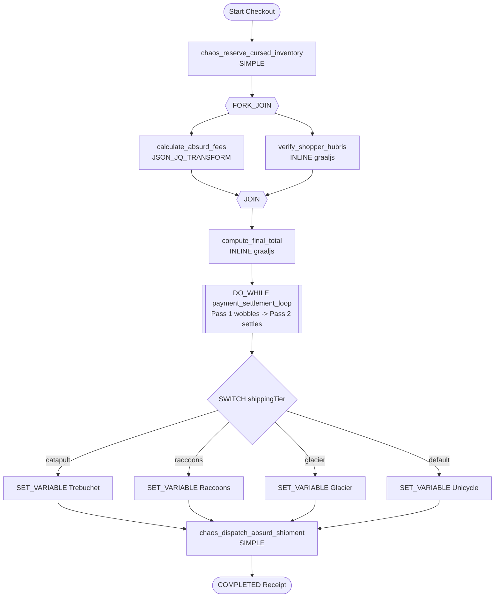
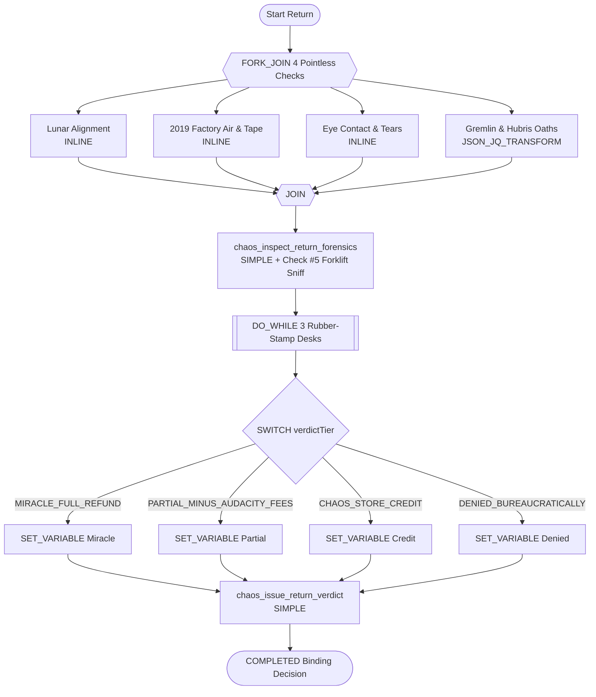

# 🔥 CHAOS COMMERCE™ — How Are We Still In Business?!

**Chaos Commerce** is a parody online storefront so hostile, overpriced, and bureaucratically unhinged that shoppers wonder how it hasn't been shut down — yet **behind every joke, checkout 100% deterministically completes and every return reaches a binding decision**, orchestrated as real [Conductor](https://github.com/conductor-oss/conductor) workflows with **zero AI API calls at runtime**.

It is structured as a clean two-workspace TypeScript monorepo:
- **`frontend/`** — Static Vite + React SPA ready to deploy straight to **GitHub Pages** (`base: "./"`, SPA `404.html` fallback, configurable `VITE_API_BASE_URL`).
- **`backend/`** — Node.js 22 TypeScript API + Conductor workers ready to deploy to **AWS Lambda** (`template.yaml` AWS SAM template + `esbuild` bundle in `backend/dist-lambda/`), reading `CONDUCTOR_SERVER_URL` from configuration.
- **`workflows/`** — Declarative Conductor task definitions and workflow definitions (`chaos_checkout_workflow` and `chaos_return_workflow`).

---

## 🚀 Quick Start (One Command)

With the Conductor server already running at `http://localhost:8080` (API at `http://localhost:8080/api`):

```bash
npm install
npm start
```

**What `npm start` does automatically:**
1. Builds `frontend/dist` and `backend/dist` if not yet built (force rebuild anytime with `FORCE_BUILD=1 npm start`).
2. Idempotently registers all 5 `SIMPLE` task definitions (`workflows/tasks/chaos_tasks.json`) and both workflow definitions (`chaos_checkout_workflow` and `chaos_return_workflow`) against `CONDUCTOR_SERVER_URL` (defaults to `http://localhost:8080/api`) — **never stopping, restarting, or replacing the Conductor server**.
3. Starts the `@io-orkes/conductor-javascript` `TaskManager` worker daemon polling all 5 task queues.
4. Serves both the Chaos Commerce storefront and `/api/*` endpoints at **`http://localhost:3000`**.

Run the automated end-to-end verification suite (against live `:3000` + `:8080/api`):

```bash
npm test
```

---

## 🎪 Parody Features & Absurd Details

- **Ridiculous Prices & Reverse Discounts**:
  - *Artisanal Single Ice Cube (Pre-Melted for Convenience)* — **$4,899.99** *(Was $0.03 — Marked UP +16,333,200%!)*
  - *Wireless Extension Cord (0 ft, Air-Gap Edition)* — **$88,888.88**
  - *Refurbished Collector's Banana (2021 Vintage, Obsidian Grade)* — **$29,999.00**
  - *Gold-Plated HDMI-to-Garden-Hose Adapter (8K @ 60 PSI)* — **$12,400.00**
- **Inverted Reviews + Cursor-Dodging 1-Star Button**:
  - **★★★★★ (5-Star Reviews)** are filled with volcanic rage from victims who couldn't catch the 1-star button.
  - **★★☆☆☆ (2-Star Reviews)** are overflowing with glowing, life-changing adoration.
  - **★☆☆☆☆ (1-Star Button)** actively dodges your mouse cursor on proximity, hover, focus, and pointer-down while taunting you and counting every juke.
- **Hostile Checkout Surcharges & Promo Roulette**:
  - Itemizes *Electron Wear-and-Tear Surcharge*, *Warehouse Raccoon Bribe ($7.77)*, *Fee Calculation Fee ($3.49)*, *Fee for Naming the Previous Fee ($0.99)*, and optional *Acts of Goose & Haunted Forklift Protection ($199.99)*.
  - Promo code `SAVE10` **adds +10%** (*CEO Yacht Fuel Contribution*); `MANAGER` **adds +$49.99**; `PLEASE` grants **-$0.01**; `CHAOS` grants **-$4.20**.
  - Shipping tiers: *Medieval Trebuchet Air-Drop*, *Three Raccoons in a Trenchcoat*, or *Continental Drift Eco-Glacier (ETA 2034)*.
- **Returns Process Buried in Pointless Checks**:
  - Interrogates shoppers on **Moon Phase**, **% of Original 2019 Factory Air Remaining**, **Exact Packing Tape Strip Count (3–19)**, **Seconds of Unbroken Eye Contact**, **Tears Shed**, **Post-Midnight Gremlin Feeding Oaths**, **1994 Maritime Bird Law**, and **Written Flattery to Warehouse Forklift #4**.
- **Extras**:
  - **Unhelpful Support Dave** (100% deterministic canned replies, zero AI APIs), **14,004 Artisanal Cookies Banner**, **Sort Alphabetically by Second Letter**, and a **Live Conductor Execution Trace Drawer** on every order and return!

---

## ⚙️ Conductor Workflows Architecture

### 1. Checkout Workflow (`chaos_checkout_workflow` v1)
Conductor UI link (local): `http://localhost:8080/workflowDef/chaos_checkout_workflow`

- **`reserve_inventory_ref` (`SIMPLE`: `chaos_reserve_cursed_inventory`)** — Validates items and reserves stock from Sub-Basement 4B / Civic trunks.
- **`parallel_surcharge_audit_fork_ref` (`FORK_JOIN` + `JOIN`)**:
  - `calculate_absurd_fees_ref` (`JSON_JQ_TRANSFORM`) — Computes absurd surcharges and shipping via `jq`.
  - `verify_shopper_hubris_ref` (`INLINE` / `graaljs`) — Evaluates hostile promo codes (`SAVE10`, `MANAGER`, `PLEASE`, `CHAOS`).
- **`compute_final_total_ref` (`INLINE` / `graaljs`)** — Computes final non-negative grand total.
- **`payment_settlement_loop_ref` (`DO_WHILE` / `graaljs`, capped `iteration < 2`)**:
  - `attempt_payment_ref` (`SIMPLE`: `chaos_attempt_payment_settlement`) — Pass #1 wobbles comedically (*"Terminal squinted judgmentally at billing zip code"*); Pass #2 **deterministically settles** so checkout **always reaches `COMPLETED`**.
  - `save_payment_state_ref` (`SET_VARIABLE`) — Captures settled transaction details.
- **`shipping_tier_switch_ref` (`SWITCH` / `value-param`)** — Routes carrier policy (`catapult`, `raccoons`, `glacier`, `defaultCase`).
- **`dispatch_shipment_ref` (`SIMPLE`: `chaos_dispatch_absurd_shipment`)** — Generates tracking number, carrier ETA, and itemized receipt.



### 2. Return Workflow (`chaos_return_workflow` v1)
Conductor UI link (local): `http://localhost:8080/workflowDef/chaos_return_workflow`

- **`pointless_checks_fork_ref` (`FORK_JOIN` + `JOIN`)** — Runs 4 pointless checks in parallel:
  1. `check_lunar_alignment_ref` (`INLINE` / `graaljs`) — Lunar & Astrological Remorse Alignment.
  2. `check_factory_air_molecules_ref` (`INLINE` / `graaljs`) — 2019 Factory Air % & Tape Strip Count (3–19).
  3. `check_contrition_and_eye_contact_ref` (`INLINE` / `graaljs`) — Unbroken Stare & Tear Salinity Audit.
  4. `check_oath_compliance_jq_ref` (`JSON_JQ_TRANSFORM`) — Sacred Hubris & Post-Midnight Gremlin Oaths.
- **`forensics_inspection_ref` (`SIMPLE`: `chaos_inspect_return_forensics`)** — Adds Check #5 (*Cardboard Vibe & Forklift #4 Flattery Sniff Test*), computes composite score (`0–100`), and assigns deterministic `verdictTier`.
- **`committee_stamp_loop_ref` (`DO_WHILE` / `graaljs`, 3 iterations)** — Routes dossier across Desk 14-A, Desk 27-B, and Desk 99-Z.
- **`verdict_routing_switch_ref` (`SWITCH` / `value-param`)** — Routes `MIRACLE_FULL_REFUND`, `PARTIAL_MINUS_AUDACITY_FEES`, `CHAOS_STORE_CREDIT`, `DENIED_BUREAUCRATICALLY` (plus safe `defaultCase`).
- **`issue_verdict_ref` (`SIMPLE`: `chaos_issue_return_verdict`)** — Issues final binding Return Decision Certificate (`decisionReached: true`).



---

## ☁️ Deploying to Production

### A. Deploy Backend to AWS Lambda

The backend compiles into a self-contained ESM bundle (`backend/dist-lambda/index.mjs` + `workflows/`) and ships with an AWS SAM template (`template.yaml`).

1. **Build the Lambda bundle:**
   ```bash
   npm run build:lambda
   ```
2. **Deploy with AWS SAM CLI:**
   ```bash
   sam build --template-file template.yaml
   sam deploy --guided \
     --parameter-overrides \
       ConductorServerUrl="https://your-conductor-host.example.com/api" \
       CorsOrigin="https://<your-github-username>.github.io"
   ```
   - `CONDUCTOR_SERVER_URL` (plus optional `CONDUCTOR_AUTH_KEY` / `CONDUCTOR_AUTH_SECRET` for authenticated Orkes/Enterprise clusters) is read strictly from Lambda environment configuration.
   - In Lambda (`WORKER_MODE=inline`), `ChaosCommerceApiFunction` drains scheduled `SIMPLE` tasks inline while awaiting workflow completion, so **no separate always-on EC2/ECS worker container is required** (an optional scheduled `ChaosCommerceWorkerFunction` is also included in `template.yaml`).
   - Orders and returns are queried directly from Conductor's workflow execution history, surviving stateless Lambda cold starts.
   - Copy the `ApiEndpoint` output URL from `sam deploy`.

### B. Deploy Frontend to GitHub Pages

1. In your GitHub repository, go to **Settings → Pages** and set **Source** to **GitHub Actions**.
2. Go to **Settings → Secrets and variables → Actions → Variables** and create a repository variable:
   - `VITE_API_BASE_URL` = `https://<your-api-id>.execute-api.<region>.amazonaws.com` (your AWS Lambda endpoint from Step A).
3. Push to `main` (or trigger `.github/workflows/deploy-pages.yml` via **Actions → Run workflow**).
   - Vite builds `frontend/dist` with relative asset paths (`base: "./"`) and `404.html` SPA fallback, publishing straight to GitHub Pages.
   - You can also override the Backend API URL live at runtime in the storefront via the **CONDUCTOR :8080 LIVE** diagnostics pill in the header.

---

## 📝 Sensible Defaults Chosen (Unattended Build Log)

Because this project was built in an unattended run without interactive prompts, the following defaults were chosen where skills or setup guides normally ask:

1. **Conductor Server & Flavor**: Connected to the existing local OSS Conductor 3.34.0 instance at `http://localhost:8080/api` (probed unauthenticated per Conductor rules; zero restarts or modifications made to `:8080`). Optional `CONDUCTOR_AUTH_KEY` / `CONDUCTOR_AUTH_SECRET` token exchange is wired in `backend/src/conductor.ts` if pointed at an Orkes/Enterprise cluster later.
2. **Conductor CLI**: Used `/usr/bin/conductor` (`v0.1.9`) already installed on `PATH`; no global `npm install -g` commands were run.
3. **Language, Framework & SDK Version**: Selected **TypeScript / Node.js 22** across both backend and frontend, pinning `@io-orkes/conductor-javascript@4.0.0` (verified from the official `conductor-oss/javascript-sdk` README and npm registry) for seamless compatibility with AWS Lambda `nodejs22.x` and Vite/React 19.
4. **System Tasks vs. `SIMPLE` Workers**: Used built-in Conductor tasks (`FORK_JOIN`, `JOIN`, `JSON_JQ_TRANSFORM`, short `INLINE` `graaljs` scripts, `DO_WHILE` with explicit `evaluatorType: "graaljs"` + iteration caps, `SWITCH`, and `SET_VARIABLE`) for orchestration, data shaping, and branching, and created 5 idempotent `SIMPLE` workers strictly for Chaos Commerce domain logic — each registered with explicit `pollTimeoutSeconds`, `responseTimeoutSeconds`, `timeoutSeconds`, and `retryCount` (verified via `conductor task list --json`).
5. **Dual Worker Execution Mode (`daemon` locally, `inline` on Lambda)**: Locally (`npm start`), `TaskManager` runs continuously as a standard polling worker daemon; on AWS Lambda (`AWS_LAMBDA_FUNCTION_NAME` set or `WORKER_MODE=inline`), the handler performs serverless poll-and-complete passes so workflows complete deterministically without needing external worker VMs.
6. **Zero Runtime AI Calls**: All workflows, fee/return evaluators, and the "Support Dave" chat widget are 100% deterministic with zero LLM tasks or AI provider calls.
