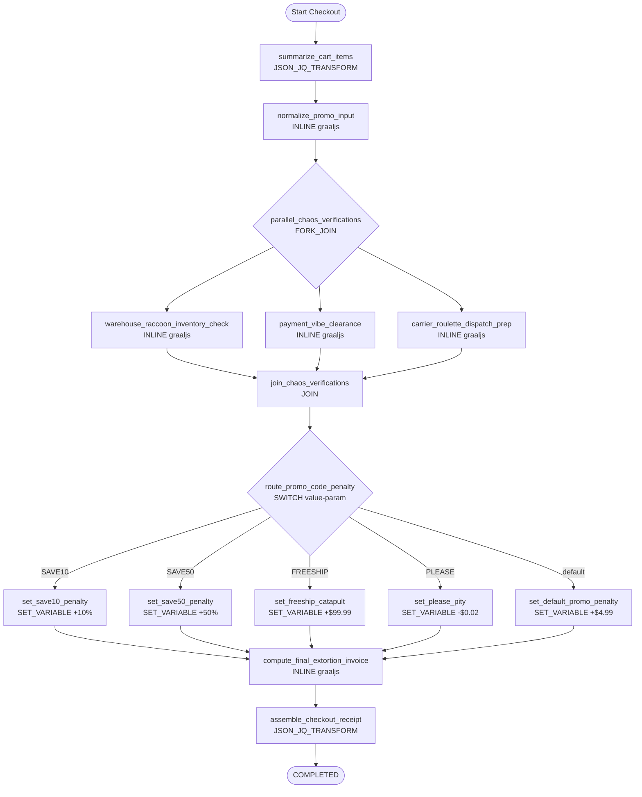
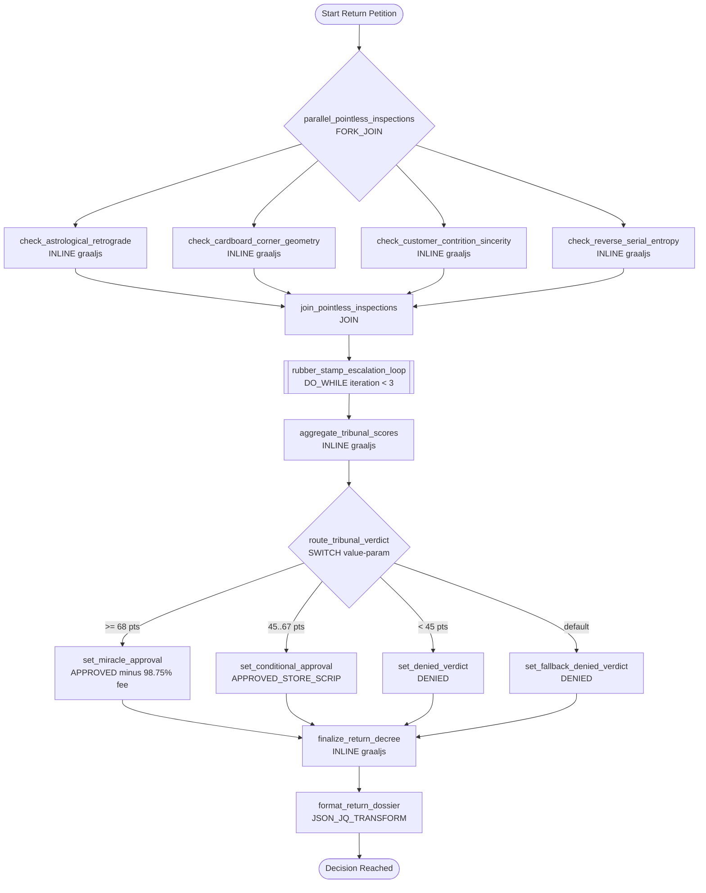

# 🔥 CHAOS COMMERCE™ — *"How Are They Still In Business?!"*

**Chaos Commerce** is a parody online store where a single damp three-heeled left sock costs **$9,499.99**, a possessed Victorian toaster costs **$0.03**, **5-star reviews** are written in blinding ALL-CAPS fury, **2-star reviews** weep with poetic adoration, the **1-star rating button physically dodges your cursor**, promo codes like `SAVE10` charge you **10% more** for your audacity, and returning an item requires passing a **7-hurdle bureaucratic tribunal** (astrology, cardboard shyness, tear salinity, backwards serial numerology, and 3 rounds of lukewarm-espresso rubber-stamping).

Behind the jokes, **every checkout always completes** and **every return always reaches a concrete decision**, orchestrated as real deterministic **Conductor workflows** (`chaos_checkout_workflow` and `chaos_return_workflow`) with **zero AI API calls at runtime**. The codebase is cleanly split so the static SPA (`frontend/`) deploys straight to **GitHub Pages** and the stateless API (`backend/`) deploys straight to **AWS Lambda**.

---

## ⚡ One-Command Local Run

Ensure your Conductor server is already running at `http://localhost:8080` (API at `http://localhost:8080/api`), then run **one command** from the repository root:

```bash
npm start
```

*(Or equivalently: `./start.sh`)*

What `npm start` does automatically:
1. Installs frontend packages if `frontend/node_modules` is not yet present.
2. Registers/updates `chaos_checkout_workflow` and `chaos_return_workflow` on `CONDUCTOR_SERVER_URL` (default `http://localhost:8080/api`) — **without stopping, restarting, or modifying the Conductor server process**.
3. Builds the production static frontend into `frontend/dist/` (with relative `./assets/...` paths).
4. Starts the unified store + API server at **`http://localhost:3000`**.

To run the automated end-to-end verification suite (against a running local server + Conductor):

```bash
npm test
```

---

## 🎪 Parody Features Tour

- **Ridiculous Pricing Spectrum**: From `$0.03` (*Slightly Haunted 2-Slice Victorian Toaster*) up to `$65,535.00` (*0.4-Inch Quantum Gold-Plated HDMI Cable*), `$12,800.00` (*Heavy Mystery Brick*), and `$3,141.59` (*1,000 × π Pre-Tangled Gordian Earbuds*).
- **Inverted Reviews (5★ Fury / 2★ Praise)**: Every product features seething 5-star rants alongside ecstatic, tearful 2-star love letters—plus an interactive composer to publish new reviews.
- **Cursor-Dodging 1-Star Button**: Available both on the storefront hero and inside every product's review form. Hovering, approaching within 78px, clicking, touching, or focusing `★☆☆☆☆ Give 1 Star` causes it to leap across the containment arena while counting escapes and taunting the shopper. Direct API attempts to submit `rating: 1` are also rejected (`HTTP 422`).
- **Backfiring Checkout Surcharges**: `SAVE10` adds a +10% *Coupon Audacity Penalty*; `FREESHIP` adds a `$99.99` *Medieval Trebuchet Rental Fee*; leaving the promo box blank adds a `$4.99` *Database Null-Byte Fee*; `PLEASE` deducts a `$0.02` *Corporate Pity Discount*. Even an empty cart checks out cleanly with a `$49.99` *Empty-Cart Atmospheric Inspection Fee*.
- **Pointless Returns Tribunal**: Subjects return petitions to Lunar Phase Astrology, Cardboard Corner Crispness (`83%–96%` sweet spot; `>96%` triggers illegal-protractor suspicion), Package Eye-Contact Shyness penalties, Tear Salinity counts, Reverse Serial Numerology, and Forklift Apology sincerity—plus 1-click presets to test every verdict tier (`APPROVED`, `APPROVED_STORE_SCRIP`, `DENIED`).
- **Extra Absurdities**: Sort products *Alphabetically by 3rd Letter*, dismiss a 14,892-cookie confession banner, chat with **Chad from No-Support™** (100% deterministic rule-based apathy, zero AI), and inspect live Conductor task timelines in the **Conductor X-Ray** tab.

---

## ⚙️ Configuration

All settings are read from environment variables (with optional `.env` loading locally; see `.env.example`):

| Variable | Default | Description |
|---|---|---|
| `CONDUCTOR_SERVER_URL` | `http://localhost:8080/api` | Conductor REST API URL (accepts bare root or `/api` suffix) |
| `CONDUCTOR_UI_URL` | Derived from `CONDUCTOR_SERVER_URL` | Base URL used for *"Open in Conductor UI"* execution links |
| `CONDUCTOR_AUTH_KEY` | *(empty)* | Optional key ID when connecting Lambda to Enterprise/Orkes Conductor |
| `CONDUCTOR_AUTH_SECRET` | *(empty)* | Optional key secret when connecting Lambda to Enterprise/Orkes Conductor |
| `CONDUCTOR_AUTH_TOKEN` | *(empty)* | Optional pre-issued `X-Authorization` token |
| `PORT` | `3000` | Local HTTP port serving the unified storefront + `/api/*` |
| `CORS_ORIGIN` | `*` | `Access-Control-Allow-Origin` returned by the backend / Lambda |
| `VITE_API_BASE_URL` | *(empty — same origin)* | Build-time frontend env var pointing GitHub Pages to your AWS Lambda URL |

---

## 🧠 Conductor Workflows

Workflow JSON definitions live in `workflows/` and use **100% native Conductor System Tasks** (`JSON_JQ_TRANSFORM`, `FORK_JOIN`, `JOIN`, `DO_WHILE`, `SWITCH`, `SET_VARIABLE`, `INLINE` with `graaljs`) and **zero `LLM_*` / `AGENT` tasks**.

### 1. `chaos_checkout_workflow` (`workflows/chaos_checkout_workflow.json`)
Always completes (`COMPLETED_NO_TAKEBACKS`), even with negative physical stock or empty carts:



### 2. `chaos_return_workflow` (`workflows/chaos_return_workflow.json`)
Runs 4 parallel pointless audits and a bounded 3-iteration rubber-stamp loop before routing to a guaranteed terminal decision (`APPROVED`, `APPROVED_STORE_SCRIP`, or `DENIED`):



---

## 🚀 Deploying to Production

### A. Deploy Backend to AWS Lambda (`backend/` + `template.yaml`)

1. Ensure your Conductor server is reachable from AWS Lambda (e.g., hosted Conductor OSS or Orkes Cloud) and register the workflows once against it:
   ```bash
   CONDUCTOR_SERVER_URL="https://your-conductor-host.example.com/api" npm run register-workflows
   ```
   *(Note: The Lambda runtime also bundles `workflows/*.json` and auto-registers them on first request if missing.)*

2. Stage the clean, zero-dependency Lambda artifact (`dist/lambda/`):
   ```bash
   npm run package:lambda
   ```

3. Deploy with **AWS SAM** (`template.yaml` configures Node.js 22, HTTP API Gateway, CORS, and `CONDUCTOR_SERVER_URL`):
   ```bash
   sam build
   sam deploy --guided \
     --parameter-overrides \
       ConductorServerUrl="https://your-conductor-host.example.com/api" \
       CorsOrigin="https://<your-github-username>.github.io"
   ```
   Copy the `ApiEndpoint` output URL (e.g. `https://abc123xyz.execute-api.us-east-1.amazonaws.com`).

   *Alternative without SAM*: Zip `dist/lambda/*`, upload to an AWS Lambda Node.js 22 function with handler `src/lambda.handler`, enable a **Lambda Function URL** (or API Gateway), and set environment variable `CONDUCTOR_SERVER_URL`.

### B. Deploy Frontend to GitHub Pages (`frontend/`)

1. In your GitHub repository, navigate to **Settings → Pages** and set **Source** to **GitHub Actions**.
2. Navigate to **Settings → Secrets and variables → Actions → Variables** and create a repository variable:
   - `VITE_API_BASE_URL` = `https://abc123xyz.execute-api.us-east-1.amazonaws.com` *(your AWS Lambda API URL, no trailing slash)*
3. Push to `main` (or trigger **Deploy Chaos Commerce Frontend to GitHub Pages** manually in Actions). `.github/workflows/deploy-pages.yml` builds `frontend/` with relative paths (`base: './'`) and publishes `frontend/dist/` to `https://<owner>.github.io/<repo>/`.

To build the GitHub Pages static bundle locally:
```bash
VITE_API_BASE_URL="https://abc123xyz.execute-api.us-east-1.amazonaws.com" npm run build:pages
# Static site output is ready in frontend/dist/
```

---

## 📝 Sensible Defaults Chosen (Unattended Run Log)

Wherever instructions or Conductor skill guidelines normally pause to ask the user, the following defaults were chosen and applied consistently:

1. **Conductor Server & Edition**: Connected directly to the existing local **OSS Conductor v3.34.0** instance at `http://localhost:8080/api` (probed unauthenticated per Conductor Skill Rule 17; zero server restarts/stops). Optional token auth (`CONDUCTOR_AUTH_KEY` / `CONDUCTOR_AUTH_SECRET`) is also supported in `backend/src/conductor.mjs` for remote deployments.
2. **Built-in Conductor System Tasks over `SIMPLE` Workers**: Used native Conductor system tasks (`FORK_JOIN`, `JOIN`, `DO_WHILE`, `SWITCH`, `SET_VARIABLE`, `JSON_JQ_TRANSFORM`, and concise `<12-line` `INLINE` `graaljs` tasks) rather than `SIMPLE` worker tasks. In AWS Lambda, background polling loops freeze between invocations; pure system tasks execute natively on the Conductor server in tens of milliseconds with **zero external worker containers required** and **zero risk of stuck `SCHEDULED` tasks**.
3. **Language & Stack**: Node.js 22 ESM (`backend/`, zero external npm runtime dependencies for instant Lambda cold starts) + React 18 & Vite 6 (`frontend/`, configured with `base: './'` and hash tab routing `#shop`, `#cart`, `#returns`, `#ledger` so GitHub Pages project subpaths work out-of-the-box).
4. **Zero Runtime AI Calls**: All pricing comedy, warehouse raccoon reports, return tribunal scoring, and Chad support replies are 100% deterministic JavaScript/JQ/GraalJS logic—no OpenAI/Anthropic/Gemini or Conductor `LLM_*`/`AGENT` calls occur at runtime.
5. **State Persistence**: Orders, returns, and user-submitted reviews persist to `backend/.data/state.json` locally and `/tmp/chaos-commerce-state.json` inside AWS Lambda warm containers, pre-seeded with 2 historical orders so returns can be tested immediately or right after checkout.
