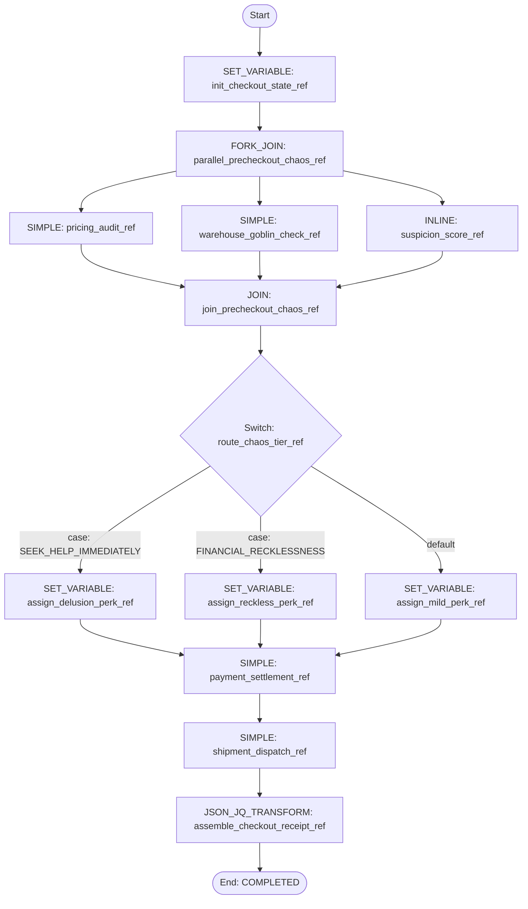
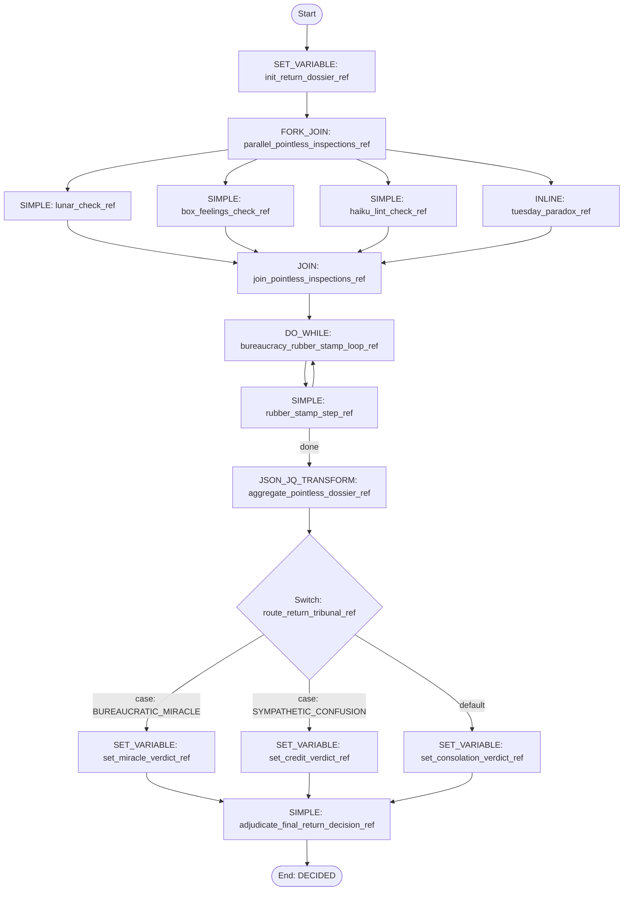

# 🔥 Chaos Commerce™

> *“Somehow still in business since Tuesday.”*

**Chaos Commerce** is a parody online store where every business decision is catastrophically wrong on the surface—yet rock-solid underneath:

- **Ridiculous Prices & Junk Fees**: Buy an *Artisanal Pre-Chewed Paperclip* for **$49,999.99**, a *Decommissioned Boeing 747 Left Wing* for **$0.03** (+ wide-load curbside sigh fee), or a *Humming Obsidian Mystery Brick* for **-$14.99** (which immediately triggers a **$199.99 Negative-Price Containment Surcharge**). Every promo code (`SAVE10`, `SAVE20`, `FREESHIP`, `SORRY`, `CHAOSVIP`) **increases** your total.
- **Inverted Customer Reviews**: Per *Chaos Commerce Bylaw §14.2*, **5-star (`★★★★★`) reviews** are pure incandescent fury (*“BANKRUPTED MY HOUSEHOLD AND ATE MY MAILBOX!!”*) while **2-star (`★★☆☆☆`) reviews** are tearful, poetic worship (*“Cured my posture and doubled my sourdough starter! 100/10 perfection!”*).
- **Cursor-Dodging 1-Star Button**: Attempting to hover, click, tap, or keyboard-focus the **`1★ (HATE IT)`** button causes it to physically sprint across the rating arena while taunting you and incrementing a global dodge counter (and even raw HTTP `1★` API submissions get intercepted by the Legal Dept and upgraded to `5★` Rage).
- **Returns Process Buried in Pointless Checks**: Returning an item requires surviving *Form 88-Z*—disclosing full-moon exposure, Mercury-in-Retrograde alibis, the cardboard box's psychological trauma, unboxing blink-count parity, spelling `"REFUND"` backwards (`"DNUFER"`), and consenting to multi-ministry rubber-stamping.
- **100% Conductor-Orchestrated & Zero Runtime AI Calls**:
  - **Every checkout (`chaos_checkout_workflow`) is guaranteed to complete** (`COMPLETED` status on Conductor), falling back to an *Unconditional Store IOU* if payment tender consists of *3 Live Geese* or *Crayon IOUs*.
  - **Every return (`chaos_return_workflow`) is guaranteed to reach a binding final decision** (`APPROVED_FULL_REFUND`, `APPROVED_CHAOS_STORE_CREDIT`, or `REJECTED_BUREAUCRATIC_TECHNICALITY` with a sympathy coupon).
  - **Zero AI / LLM APIs are called at runtime** (`runtimeAiCalls: 0`).

---

## 🚀 Quick Start (One Command)

Assuming Conductor is already running at `http://localhost:8080` (API at `http://localhost:8080/api`):

```bash
npm start
```

That single command:
1. Ensures dependencies and static frontend assets (`frontend/dist`) are built, and syncs workflow JSON definitions.
2. Registers all **9 Conductor `SIMPLE` task definitions** (`workflows/taskdefs.json`) and all **3 Conductor workflow definitions** (`chaos_checkout_workflow`, `chaos_return_workflow`, `chaos_emergency_recovery_workflow`) against `CONDUCTOR_SERVER_URL` (`http://localhost:8080/api` by default) and verifies the Worker Gate.
3. Starts the Conductor background workers (`@io-orkes/conductor-javascript`) polling for tasks.
4. Serves both the backend API (`/api/*`) and the storefront UI at **[http://localhost:3000](http://localhost:3000)**.

To run the automated end-to-end verification suite against the running store and Conductor server:

```bash
npm run verify
```

---

## ⚙️ Configuration

All backend scripts (`npm start`, `npm run register`, `npm run worker`, and the AWS Lambda handler) read Conductor connection settings from environment variables:

| Variable | Default | Description |
|---|---|---|
| `CONDUCTOR_SERVER_URL` | `http://localhost:8080/api` | Conductor REST API URL (`/api` is automatically appended if omitted) |
| `CONDUCTOR_UI_URL` | Derived from `CONDUCTOR_SERVER_URL` | Base URL for deep links to Conductor UI executions & workflow definitions |
| `CONDUCTOR_AUTH_KEY` | *(empty — OSS mode)* | Optional Key ID for Orkes / Enterprise Conductor |
| `CONDUCTOR_AUTH_SECRET` | *(empty — OSS mode)* | Optional Key Secret for Orkes / Enterprise Conductor |
| `CONDUCTOR_AUTH_TOKEN` | *(empty)* | Optional pre-issued `X-Authorization` JWT token |
| `PORT` | `3000` | Local HTTP server port |
| `CORS_ORIGIN` | `*` | `Access-Control-Allow-Origin` header for cross-origin GitHub Pages requests |
| `CHAOS_DATA_DIR` | `/tmp/chaos-commerce-data` | Writable directory for persisted reviews, orders, returns, and dodge counter |
| `VITE_API_BASE_URL` | `""` *(same-origin)* | Frontend build-time API base URL (set to your AWS Lambda API Gateway URL when deploying to GitHub Pages; can also be overridden live in the UI's **⚙️ Conductor Live** tab) |

---

## 🔀 Conductor Workflows

Workflow definitions live in [`workflows/`](./workflows) and can also be inspected in the Conductor UI:

- Checkout Workflow UI: `http://localhost:8080/workflowDef/chaos_checkout_workflow`
- Return Workflow UI: `http://localhost:8080/workflowDef/chaos_return_workflow`
- Failure Recovery Workflow UI: `http://localhost:8080/workflowDef/chaos_emergency_recovery_workflow`

### 1. `chaos_checkout_workflow`
Initializes order state, runs absurd pricing math, haunted warehouse allocation, and buyer suspicion scoring in parallel, branches on the buyer's chaos tier to assign a dubious perk, settles any payment method irrevocably, dispatches an absurd carrier, and formats the confirmed receipt via JQ.



### 2. `chaos_return_workflow`
Executes 4 pointless bureaucratic inspections in parallel (lunar/astrology audit, cardboard box trauma screening, backward `"DNUFER"` spelling & blink-parity check, and temporal letter-`Q` audit), runs a bounded `DO_WHILE` rubber-stamp loop across up to 4 fictional sub-ministries, aggregates the absurdity score via JQ, routes via `SWITCH`, and adjudicates a guaranteed binding decision.



---

## ☁️ Deployment Guide

### A. Deploying the Backend to AWS Lambda

The backend in [`backend/`](./backend) is built around a framework-agnostic request router (`backend/src/app.js`) exposed as an AWS Lambda handler in [`backend/src/lambda.js`](./backend/src/lambda.js) (compatible with API Gateway HTTP API v2, REST API v1, and Lambda Function URLs) and packaged via [`template.yaml`](./template.yaml) (AWS SAM).

**Serverless Worker Architecture**: On AWS Lambda, there is no idle background process between invocations. When `AWS_LAMBDA_FUNCTION_NAME` is present, `executeWorkflowGuaranteed()` automatically runs a cooperative inline task-drainer during workflow execution so all `SIMPLE` tasks queued on your Conductor server complete in ~200ms with **zero separate EC2/ECS worker servers required**. (For high-volume deployments, you can also run `npm run worker` as a dedicated background worker service.)

#### Deploy with AWS SAM:
```bash
# 1. Sync latest workflow JSON definitions into backend/workflows/
npm run build

# 2. Build and deploy to AWS Lambda + HTTP API Gateway
sam build
sam deploy --guided \
  --parameter-overrides \
    ConductorServerUrl="https://your-conductor-host.example.com/api" \
    AllowedCorsOrigin="https://<your-github-username>.github.io"
```
Copy the `ChaosApiBaseUrl` CloudFormation output (e.g. `https://abc123xyz.execute-api.us-east-1.amazonaws.com`) for your GitHub Pages build.

*(Note: Never pass `ConductorAuthKey` / `ConductorAuthSecret` in plain shell history—supply them interactively when `sam deploy --guided` prompts for `NoEcho` parameters or via AWS Secrets Manager / Lambda console environment variables.)*

#### Alternative: Direct Zip Upload to AWS Lambda:
```bash
npm run build
cd backend && zip -r ../chaos-lambda.zip . && cd ..
```
Upload `chaos-lambda.zip` to a Node.js 22.x Lambda function with handler `src/lambda.handler`, timeout `30s`, and environment variable `CONDUCTOR_SERVER_URL` pointing to your Conductor server.

---

### B. Deploying the Frontend to GitHub Pages

The frontend in [`frontend/`](./frontend) is a pure static React + Vite SPA configured with `base: "./"` so all asset URLs work cleanly at either a custom domain root or a `https://<username>.github.io/<repo>/` subpath.

#### Option 1: Automated GitHub Actions (Included)
1. In your GitHub repository, go to **Settings → Pages** and set **Source** to **GitHub Actions**.
2. Go to **Settings → Secrets and variables → Actions → Variables** and create a repository variable named `VITE_API_BASE_URL` set to your deployed AWS Lambda `ChaosApiBaseUrl` (no trailing slash).
3. Push to `main` (or trigger `.github/workflows/deploy-pages.yml` manually via **Actions → Run workflow**).

#### Option 2: Manual Build for Any Static Host / `gh-pages` Branch
```bash
VITE_API_BASE_URL="https://abc123xyz.execute-api.us-east-1.amazonaws.com" npm --prefix frontend run build
```
Publish the generated `frontend/dist/` directory to GitHub Pages. You can also test or switch backend URLs at runtime in the storefront under **⚙️ Conductor Live → API Endpoint Configuration** (or via `?apiBase=https://...`).

---

## 📋 Unattended Run Decisions & Sensible Defaults

Per run instructions, wherever a skill or workflow guide normally pauses to ask a question, sensible defaults were chosen and documented below:

1. **Conductor Server & Flavor (Conductor Skill Rules 14, 15, 17)**: Connected to the pre-existing unauthenticated **OSS Conductor** server at `http://localhost:8080` (`CONDUCTOR_SERVER_URL=http://localhost:8080/api`) without stopping, restarting, or replacing it, while supporting Enterprise/Orkes auth (`CONDUCTOR_AUTH_KEY` / `CONDUCTOR_AUTH_SECRET` / `CONDUCTOR_AUTH_TOKEN`) via env vars for cloud deployments.
2. **CLI & Global Package Policy (Conductor Skill Rule 3)**: Used the pre-installed `/usr/bin/conductor` CLI (`v0.1.9`) and REST API directly; installed zero global npm packages.
3. **Worker Language & SDK Version (Conductor Skill Rule 7)**: Selected **JavaScript / Node.js 22 ESM** with `@io-orkes/conductor-javascript@4.0.0` (verified from `conductor-oss/javascript-sdk` README and npm registry) so the local server, Conductor workers, and AWS Lambda function share one codebase and runtime.
4. **System Tasks vs. `SIMPLE` Workers (Conductor Skill Rules 1, 6 & Optimization Checklist)**: Used built-in Conductor tasks (`SET_VARIABLE`, `FORK_JOIN`, `JOIN`, `SWITCH`, bounded `DO_WHILE` with explicit `evaluatorType: "graaljs"` + iteration cap `< 4`, `JSON_JQ_TRANSFORM`, and <10-line `INLINE` GraalJS scripts) for orchestration/control flow, paired with 9 idempotent `SIMPLE` workers with full task definitions (`responseTimeoutSeconds: 15`, `pollTimeoutSeconds: 30`, `timeoutSeconds: 60`, `retryCount: 2`) and `chaos_emergency_recovery_workflow` configured as `failureWorkflow`.
5. **Serverless Execution Strategy**: Combined continuous background `TaskManager` polling in local server mode (`npm start`) with a cooperative inline task-drainer in AWS Lambda mode so stateless serverless deployments complete workflows without requiring separate EC2/ECS worker instances.
6. **Frontend Framework & Routing**: Used **React 18 + Vite** with relative asset paths (`base: "./"`) and state-based tab navigation so GitHub Pages subpath deployments never hit SPA 404 refresh issues.
7. **Zero Runtime AI Calls**: Implemented all pricing chaos, inverted review logic, dodging 1-star physics, bureaucratic checks, and unhelpful support chat deterministically with zero external AI/LLM API calls.
