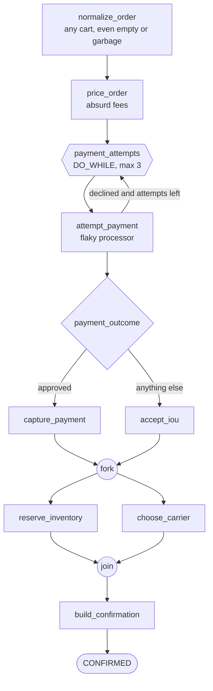
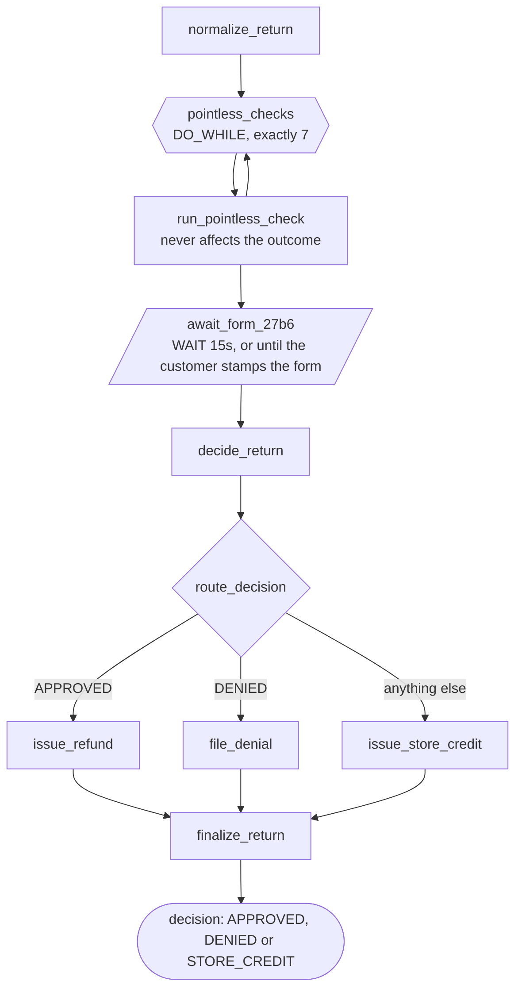

# Chaos Commerce

A parody online store so bad you wonder how it is still in business: a pre-drained battery for $849.99,
five-star reviews written in fury, two-star reviews glowing with praise, a one-star button that runs away
from your cursor, coupons that raise the price, and a returns process buried in pointless checks.

Behind the jokes, two things are real and dependable:

- **Checkout always completes.** It runs as the Conductor workflow `chaos_checkout`.
- **Every return reaches a decision.** It runs as the Conductor workflow `chaos_returns`.

Nothing calls an AI API at runtime. Every joke is hand-written, static text.

## Run it

Requirements: Node.js 20.12 or newer, and a Conductor server (default `http://localhost:8080/api`).
There is nothing to install: the project has no npm dependencies.

```bash
npm start
```

That one command:

1. reads the configuration (environment variables, or a `.env` file; see `.env.example`),
2. registers both workflows on the Conductor server (an idempotent upsert, safe to repeat),
3. serves the store at **http://localhost:3000** (frontend and `/api` on the same port).

It only talks to Conductor over its REST API. It never starts, stops or restarts the Conductor server.
If Conductor is not up yet, it retries for a minute, then serves the store anyway and registers the
workflows on the first checkout or return. If the store is already running on that port, the command
registers the workflows again, says so and exits; stop the running copy first to restart it
(`PORT=3001 npm start` uses another port).

Other commands:

| Command | What it does |
|---|---|
| `npm run register` | Registers the workflows and exits |
| `npm test` | Unit tests (fake Conductor) and static checks on the workflow definitions |
| `npm run e2e` | End-to-end checks against the running store and the real Conductor |
| `npm run build:workflows` | Regenerates `backend/workflows/*.json` from the readable sources |

## Configuration

| Variable | Default | Meaning |
|---|---|---|
| `CONDUCTOR_SERVER_URL` | `http://localhost:8080/api` | Conductor API base URL. `/api` is appended if you give a bare root. |
| `CONDUCTOR_UI_URL` | server URL without `/api` | Base for "view execution" links. Empty string hides them. |
| `CONDUCTOR_AUTH_KEY`, `CONDUCTOR_AUTH_SECRET` | unset | Only for a secured (Orkes) Conductor. Not needed for the local server. |
| `CORS_ALLOW_ORIGIN` | `*` | Origin allowed to call the API (set it to your GitHub Pages origin in production). |
| `PORT` / `HOST` | `3000` / all interfaces | Local server only. |
| `CONDUCTOR_TIMEOUT_MS` | `12000` | Per-request timeout towards Conductor. |
| `CHECKOUT_WAIT_MS` | `8000` | How long `POST /api/checkout` waits for the confirmation before answering "processing". |

The frontend has one setting, `apiBaseUrl` in `frontend/config.js`. Empty means "same origin" (local).
For GitHub Pages it is the URL of the Lambda backend.

## Layout

```
frontend/                 Static site (plain HTML, CSS, ES modules; no build step)  -> GitHub Pages
  config.js               The only environment-specific file (apiBaseUrl)
backend/                  Dependency-free Node.js API                               -> AWS Lambda
  src/lambda.mjs          Lambda handler (API Gateway v1/v2 and Function URL events)
  src/app.mjs             Routes and business rules
  src/conductor.mjs       Small Conductor REST client
  src/catalog.mjs         Products, prices and reviews
  workflows/*.json        The two workflow definitions (what gets registered)
  workflows/src/*.mjs     Readable sources the JSON is generated from
  template.yaml           AWS SAM template
scripts/start.mjs         The one command (register + serve)
.github/workflows/        Deploy frontend to Pages, deploy backend to Lambda
```

Locally, `scripts/start.mjs` feeds API Gateway-shaped events to the same Lambda handler that runs in
AWS, so there is no separate "local backend" to drift from production.

The backend keeps no state. An order is a `chaos_checkout` execution and a return is a `chaos_returns`
execution, each found by its correlation id (the order or return number). That is what lets it run on Lambda.

## The workflows

Both use only Conductor system tasks (`JSON_JQ_TRANSFORM`, `INLINE`, `DO_WHILE`, `SWITCH`, `FORK_JOIN`,
`JOIN`, `WAIT`). There are no `SIMPLE` tasks, so there is no worker whose absence could leave an order
stuck, and nothing for Lambda to poll. Every script catches its own errors and falls back to a safe value.

### `chaos_checkout`



Why it always completes: an empty cart is sold "Nothing (Deluxe Edition)"; three declined payment attempts
fall through to an IOU, which is always accepted (the IOU branch is the `SWITCH` default); the loop is
capped at three iterations.

### `chaos_returns`



Why it always decides: the only place it waits is a `WAIT` task with a fixed 15 second duration written
into the definition. The store completes that task early when the customer stamps Form 27B/6; if they
never do, the timer expires and the return is decided anyway. Store credit is the `SWITCH` default.

Payment luck, check results and return decisions come from a hash of the order or return number, so a
retried or restarted execution reaches the same result.

### Recovery

If an execution ends `FAILED`, `TIMED_OUT` or `TERMINATED` (an operator accident or an outage), the backend
calls Conductor's retry (falling back to restart) the next time anyone looks at that order or return, and
reports `RECOVERING` until it completes. The browser reuses its order number when it retries a checkout,
and the backend returns the existing order for a number it has already seen, so retries never double-order.

## API

| Method and path | Purpose |
|---|---|
| `GET /api/health` | Backend, Conductor reachability, workflows registered |
| `GET /api/products` | Catalog, shipping options, return reasons |
| `POST /api/checkout` | `{orderId?, customer?, items:[{id, qty}], coupon?, shipping?}`. Returns `201` with the confirmation, `200` for a repeated `orderId`, or `202` if still processing |
| `GET /api/orders/{orderId}` | Order state, confirmation, workflow steps |
| `POST /api/returns` | `{returnId?, orderId, itemId, reason, answers?}`. Starts the return |
| `GET /api/returns/{returnId}` | Checks so far, form countdown, decision |
| `POST /api/returns/{returnId}/form` | Stamps Form 27B/6 (completes the `WAIT` task). `409` if too late |

Prices always come from the backend catalog; a price sent by the browser is ignored.

## Deploy

Neither deployment was run from this machine (there is no AWS account or GitHub repository here).
What was checked: the SAM template passes `cfn-lint`, the Lambda handler is what serves `/api` locally,
and the frontend was tested from a different origin than the backend (CORS).

### Backend to AWS Lambda

Lambda cannot reach `localhost`. Use a Conductor URL that is reachable from AWS.

```bash
cd backend
sam deploy --guided --template-file template.yaml --stack-name chaos-commerce-backend \
  --capabilities CAPABILITY_IAM --resolve-s3
# answer the prompts: ConductorServerUrl=https://your-conductor.example.com/api
#                     CorsAllowOrigin=https://your-user.github.io
cd .. && CONDUCTOR_SERVER_URL=https://your-conductor.example.com/api npm run register
```

The stack output `ApiBaseUrl` is the value the frontend needs. The function has no dependencies, so there
is no build step. `.github/workflows/deploy-backend.yml` does the same from CI (setup is described at the
top of that file). If you skip `npm run register`, the function registers the workflows itself the first
time a checkout or return finds them missing.

### Frontend to GitHub Pages

1. Push this project to a GitHub repository.
2. Settings, Pages: set the source to "GitHub Actions".
3. Settings, Secrets and variables, Actions, Variables: add `CHAOS_API_BASE_URL` with the `ApiBaseUrl` value.
4. Push to `main` (or run "Deploy frontend to GitHub Pages" by hand).

`.github/workflows/deploy-frontend.yml` writes `frontend/config.js` from that variable and publishes
`frontend/`. The site uses relative asset paths and hash routes (`#/cart`), so it works under
`https://user.github.io/repo/`. To publish by hand instead, edit `frontend/config.js` and upload the folder.

## Decisions made without asking

This was built unattended, so every point where the Conductor skill or the brief would normally ask a
question was settled with a default:

| Question | Default chosen |
|---|---|
| Which Conductor server and credentials? | The one named in the brief, `http://localhost:8080/api`. It answers without credentials, so it is treated as open-source Conductor with no auth. No CLI profile was saved. |
| Install the Conductor CLI globally? | Not needed. `conductor` v0.1.9 was already on the PATH. Nothing was installed globally. `npm start` uses the REST API directly, so it does not need the CLI. |
| Create task definitions or scaffold workers, and in which language? | Neither. The workflows contain no `SIMPLE` tasks, so there is nothing to register or poll. A worker would also be the one thing that could make checkout hang, and Lambda cannot host a long-lived poller. The backend is plain Node.js. |
| LLM or agent tasks? | None. The brief forbids AI calls at runtime. |
| Apply the workflow review findings? | Reviewed against the skill's checklist and applied: descriptions, owner email, schema version 2, loop caps, workflow timeouts. Three deliberate deviations: the timeout policy is `ALERT_ONLY` (a slow checkout is flagged, never killed); a few `INLINE` scripts are longer than the suggested 15 lines (the alternative was a worker); there is no `failureWorkflow` (nothing external to clean up, and failed executions are retried by the backend). |
| Workflow versioning | Both are version 1 and were updated in place during development. Bump `version` for later changes. |
| How long to wait for Form 27B/6? | 15 seconds, fixed in the definition. A computed duration that resolved to null would wait forever. |
| What if the cart is empty or names unknown products? | Still a checkout. Empty carts get "Nothing (Deluxe Edition)"; unknown products become a "Mystery Item"; quantities are clamped to 1 to 99. |
| What if the order in a return does not exist? | The return is accepted and decided anyway. |
| Where do orders live? | In Conductor only. No database. |
| Customer reviews | Shipped with the catalog. Reviews a visitor writes stay in that browser's local storage. |
| Security defaults | No login, no payment data. CORS defaults to `*`; the local server listens on all interfaces. Set `CORS_ALLOW_ORIGIN` and `HOST` to tighten either. |
| Git | No repository was initialised. Run `git init` when you are ready to push. |

## Known limits

- Open-source Conductor ignores the `idempotencyKey` field, so duplicate checkouts are prevented by looking
  up the order number before starting. Two identical requests arriving in the same instant can still start
  two executions; the store always shows the older one.
- Conductor runs these system tasks inline, so starting a checkout takes about a second and a busy server
  slows down. If a start request times out, the backend looks the order up and carries on instead of failing.
- Automatic recovery restarts executions that an operator terminated on purpose. That is intended here
  ("always completes") but would be wrong for a real store.
