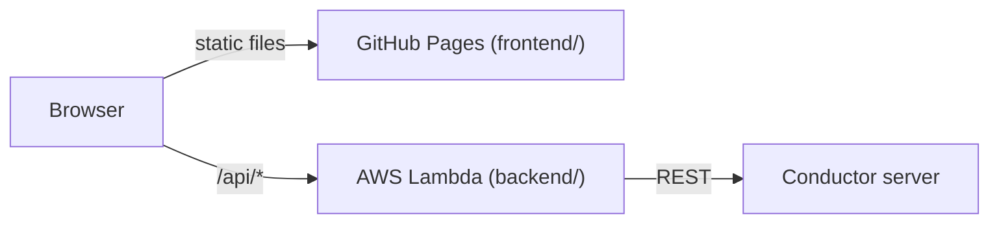
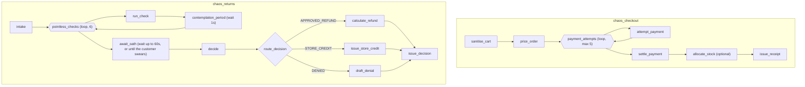

# Chaos Commerce

A parody online store that is bad on purpose: a single left sock for $4,999.99, coupons that cost extra, furious five-star reviews, glowing two-star reviews, a one-star button that runs away from the cursor, and a returns department with six pointless checks and an oath.

Behind the jokes, two things are engineered properly. **Checkout always completes** and **every return reaches a decision**, and both run as [Conductor](https://conductor-oss.org) workflows.

Nothing is for sale. No payment details are requested and no money moves.

## Run it

You need Node.js 20.12 or newer and a running Conductor server. There is nothing to install.

```bash
npm start
```

That one command:

1. reads the Conductor URL from configuration (`CONDUCTOR_SERVER_URL`, default `http://localhost:8080/api`),
2. registers the four workflows with Conductor (it only adds or updates definitions; it never stops or restarts the server),
3. serves the store at **http://localhost:3000**.

Stop it with Ctrl+C. If port 3000 is taken, use `PORT=3001 npm start`.

No AI or LLM API is called at any point. All the copy is static and all the "randomness" is derived from the order number.

### Things to try

- Open a product and try to give it one star. With a mouse or a finger the button dodges; with the keyboard it "rounds up" to five.
- Buy three of something with a coupon and read the receipt: bulk surcharge, coupon fee, convenience fee, inconvenience fee, a fee on the fees.
- Check out with an empty cart. It works, and there is a fee for that.
- From the receipt, return an item. Watch the six checks run, then type the Returns Oath within 60 seconds, or walk away and come back to find the return decided without you.
- Follow the "See how this was processed" link on a receipt or decision to open the execution in the Conductor UI.

## How it is put together

```
frontend/   static site (HTML, CSS, ES modules, no build step)  ->  GitHub Pages
backend/    stateless HTTP API, one Lambda handler              ->  AWS Lambda
conductor/  workflow definitions                                ->  your Conductor server
scripts/    start.js (the one command) and register.js
tests/      unit tests and tests against a live Conductor
```



Locally, `npm start` plays both hosting roles in one process: it serves `frontend/` as static files and passes `/api/*` requests to the same Lambda handler that AWS would run.

The backend keeps no state. Orders and returns live in Conductor as workflow executions; the browser remembers its own orders, returns and reviews in `localStorage`.

### The workflows

Sources are in `conductor/src/` (jq programs in `conductor/src/jq/`); the registrable JSON in `conductor/workflows/` is generated from them by `npm run build:workflows`, which `npm start` and `npm run register` run for you.

| Workflow | What it does |
| --- | --- |
| `chaos_checkout` | Sanitises the cart, prices it, tries payment processors in a loop, allocates stock, issues the receipt. |
| `chaos_checkout_rescue` | Issues an emergency receipt (at cost, fees waived) for a checkout that did not complete. |
| `chaos_returns` | Runs six checks with a one-second pause after each, waits for the Returns Oath, decides, issues the decision letter. |
| `chaos_returns_default_decision` | Approves a return in full when the returns workflow did not finish. |



All tasks are Conductor system tasks (`JSON_JQ_TRANSFORM`, `DO_WHILE`, `WAIT`, `SWITCH`). There are no worker tasks, so there is no worker process to run and no step that can sit waiting for one.

### Why checkout always completes

- **Nothing is rejected.** The backend drops unknown products, clamps quantities and falls back to default shipping and payment choices. The workflow's first task does the same again, so even a checkout started by hand in Conductor with `{}` as input completes (and is charged the Empty Cart Handling Fee).
- **Payment cannot fail.** Processors are tried in a loop capped at five attempts; the fifth, "IOU Written on a Napkin", accepts everything.
- **Nothing waits on anything external.** No workers, no HTTP calls, no human steps.
- **There is a safety net.** If the workflow fails or exceeds its 120-second timeout, Conductor starts `chaos_checkout_rescue` (its `failureWorkflow`), which confirms the order at cost. If an operator terminates a checkout, the backend starts the same rescue workflow the next time the order is read.
- **Retries do not duplicate orders.** The browser sends a token with each checkout; the backend uses it as the Conductor correlation id and returns the existing order if one was already started. The order number is derived from the token.

### Why every return reaches a decision

- **The oath wait is bounded.** `await_oath` is a `WAIT` task with a duration. The customer's oath completes it early; otherwise it ends by itself and the return is decided without the oath (denied, "no oath on file").
- **The checks cannot block.** They are a fixed loop of six. Their verdicts are recorded and, as the decision letter admits, never consulted.
- **Both wait durations are clamped inside the workflow**, because a `WAIT` with a missing or malformed duration would never end.
- **There is a safety net here too.** On failure or after the 900-second timeout, Conductor starts `chaos_returns_default_decision`, which approves the return in full. A return terminated by an operator gets the same decision via the backend.

### Limits you should know about

- If Conductor cannot be reached, nothing can run. The API answers 503, the storefront keeps the cart and retries, and the order goes through once Conductor is back.
- A workflow that an operator has *paused* stays paused until it is resumed.
- On the Conductor server this was built against, a workflow timeout was only applied when the workflow was next evaluated, not by a background sweep. The backend therefore asks Conductor to re-evaluate an overdue workflow whenever its status is read.
- Two requests with the same token arriving at the same instant can start two executions. They produce the same order number and the same receipt.
- Names and email addresses typed at checkout are stored in the Conductor execution. Do not enter real ones; the store says so too.

## Configuration

Everything is read from environment variables. For local use you can put them in a `.env` file (see `.env.example`).

| Variable | Default | Meaning |
| --- | --- | --- |
| `CONDUCTOR_SERVER_URL` | `http://localhost:8080/api` locally; required on Lambda | Conductor API base URL. A bare root such as `http://host:8080` gets `/api` appended. |
| `CONDUCTOR_AUTH_KEY`, `CONDUCTOR_AUTH_SECRET` | none | Only for Conductor servers that require authentication (Orkes). |
| `CONDUCTOR_UI_URL` | Conductor server root locally; off on Lambda | Enables the "see the workflow" links. |
| `ALLOWED_ORIGINS` | `*` | Origins allowed to call the API, comma-separated. |
| `OATH_WINDOW_SECONDS` | `60` | How long a return waits for the oath (5 to 600). |
| `CHECK_PAUSE_SECONDS` | `1` | Pause after each returns check (1 to 5). |
| `PORT` | `3000` | Port for `npm start`. |

The storefront has one setting, `apiBaseUrl` in `frontend/config.js`. Empty means "same origin", which is what `npm start` uses.

## Tests

```bash
npm test                  # unit tests; no Conductor needed
npm run test:integration  # runs real checkouts and returns on your Conductor server (about 40 seconds)
```

The integration tests register the workflows and leave their executions behind in Conductor.

## Deploy

Neither deployment below has been run from this repository; no AWS account or GitHub repository was available when it was built. The SAM template passes `cfn-lint`, and the Lambda handler is the code path every local request goes through.

### 1. Register the workflows on the Conductor server you will use

Lambda cannot reach `localhost`, so the deployed backend needs a Conductor server it can reach over the network.

```bash
CONDUCTOR_SERVER_URL=https://conductor.example.com/api npm run register
```

For a server that requires authentication, also set `CONDUCTOR_AUTH_KEY` and `CONDUCTOR_AUTH_SECRET` in your shell. Do not put them on the command line or in a committed file.

### 2. Backend to AWS Lambda

`backend/` is self-contained and has no dependencies. `backend/template.yaml` is an AWS SAM template that creates one Node.js 22 function behind an API Gateway HTTP API.

```bash
cd backend
sam deploy --guided \
  --stack-name chaos-commerce \
  --parameter-overrides \
    ConductorServerUrl=https://conductor.example.com/api \
    AllowedOrigins=https://YOUR-NAME.github.io
```

The stack output `ApiBaseUrl` is the address the storefront needs. Check it with `curl <ApiBaseUrl>/api/health`: it reports whether Conductor is reachable and whether the four workflows are registered.

The API is public and unauthenticated, like any shop front. The template throttles it to 10 requests a second.

### 3. Frontend to GitHub Pages

1. Push this repository to GitHub with `main` as the default branch.
2. In **Settings > Pages**, set the source to **GitHub Actions**.
3. In **Settings > Secrets and variables > Actions > Variables**, add `CHAOS_API_BASE_URL` with the `ApiBaseUrl` from step 2.
4. Push to `main`, or run the "Deploy storefront to GitHub Pages" workflow by hand.

The workflow (`.github/workflows/deploy-frontend.yml`) writes `frontend/config.js` from that variable and publishes `frontend/` unchanged. All links in the storefront are relative and routing uses the URL hash, so it works under `https://YOUR-NAME.github.io/REPO/`.

## Decisions made without asking

This was built in one unattended run, so wherever there was a choice to make, a default was picked:

| Question | Default chosen |
| --- | --- |
| Which Conductor server? | The one at `http://localhost:8080/api`, as instructed. It answers without credentials, so it was treated as open-source Conductor with no authentication, and no CLI profiles were created. |
| Install the Conductor CLI globally? | Not needed. A `conductor` CLI was already installed and was used only for inspection; the project registers workflows over REST so it does not depend on the CLI. |
| Which language for workers? | None. The workflows use system tasks only. A Lambda backend cannot host long-polling workers, and a checkout that depends on a worker can hang when the worker is down. |
| Business logic in jq rather than a worker? | Yes, for the reason above. The jq is kept in separate, commented files to stay readable. |
| Workflow owner email | `chaos-commerce@example.com`, a placeholder. Change it in `conductor/src/*.json`. |
| Workflow versioning | Version 1, updated in place each time `npm start` or `npm run register` runs. Bump the version instead if you change a definition while executions are in flight. |
| What does the safety net decide? | In the customer's favour: a rescued checkout is charged no fees, and a return that could not be processed is approved in full. |
| What happens to an abandoned return? | It is denied when the oath window closes. |
| How does Lambda get an HTTP endpoint? | API Gateway HTTP API, defined with AWS SAM. Region and stack name are left to whoever deploys. |
| CORS | Any origin by default; restrict it with `ALLOWED_ORIGINS`. |
| Payment details | Never requested. Payment methods are a firm handshake, exposure and similar. |
| Customer reviews | Saved in the visitor's browser only. |
| Product pictures | Emoji. "Image coming soon since 2009." |
| Dependencies | None, in the frontend, the backend or the tooling. |
| Version control | `git init` was run so the Pages workflow has somewhere to live; nothing was committed. |
