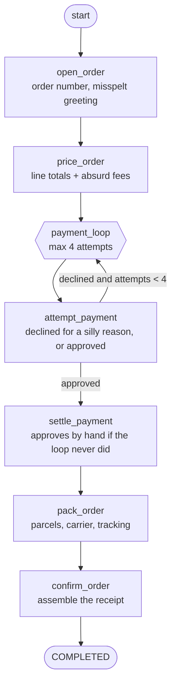
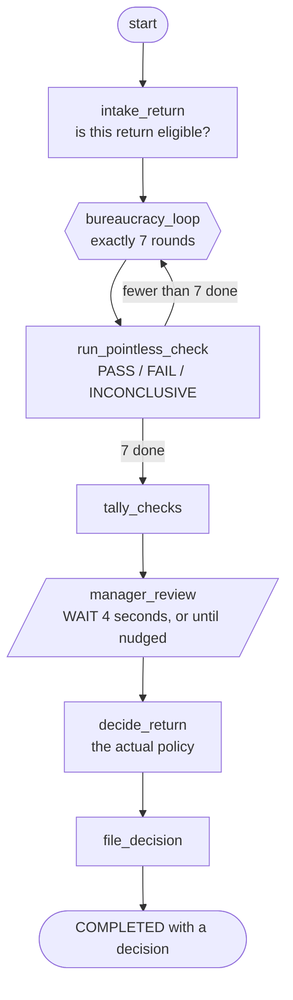

# Chaos Commerce 🛒

A parody online store that is bad on purpose: a pre-drained AA battery for $4,999.99, a superyacht for
three cents, five-star reviews written in fury, two-star reviews written in bliss, a one-star button that
runs away from the cursor, and a returns process buried in pointless checks.

Behind the jokes, two things are real:

- **Checkout always completes.** Every order is a run of the `chaos_checkout` Conductor workflow.
- **Every return reaches a decision.** Every return is a run of the `chaos_return` Conductor workflow.

Nothing is sold, charged or shipped, and the store never asks for payment details. No AI API is called
at runtime; every joke is written into the code.

## Run it

Requirements: Node.js 20.12 or newer, and a Conductor server (by default the one at
`http://localhost:8080`). There is nothing to install: the project has no npm dependencies.

```bash
npm start
```

That one command:

1. reads the configuration (environment variables, plus `.env` if you create one),
2. registers both workflows on the Conductor server (it only talks to the server's API; it never starts,
   stops or restarts Conductor),
3. serves the storefront and the API together at **http://localhost:3000**.

Stop it with Ctrl+C. If Conductor is not answering yet it retries for about 30 seconds, then exits with
an error. If port 3000 is taken it says so and exits.

### Configuration

| Variable | Default | Meaning |
| --- | --- | --- |
| `CONDUCTOR_SERVER_URL` | `http://localhost:8080/api` | Conductor API base URL. A bare server root gets `/api` appended. |
| `CONDUCTOR_AUTH_KEY`, `CONDUCTOR_AUTH_SECRET` | empty | Access key for a Conductor server that requires authentication. Leave empty otherwise. |
| `PORT` | `3000` | Port of the local store. |
| `ALLOWED_ORIGIN` | `*` | Origin allowed to call the API from another site (CORS). |
| `CHECKOUT_WAIT_MS` | `12000` | How long `POST /api/checkout` waits for the workflow before answering `202`. |
| `WORKFLOW_OWNER_EMAIL` | `chaos-commerce@example.com` | `ownerEmail` written into the workflow definitions at registration. |

Set them in the shell or copy `.env.example` to `.env`. The storefront has one setting of its own,
`apiBaseUrl` in `frontend/config.js` (empty means "the server that served this page").

### Other commands

| Command | What it does |
| --- | --- |
| `npm test` | Unit tests: workflow logic, workflow definitions, API handler, Lambda handler (no network). |
| `npm run test:e2e` | End-to-end tests against the running store and the real Conductor server. Run `npm start` first. |
| `npm run register` | Registers the workflows only (used when deploying). |
| `npm run build:workflows` | Regenerates the JSON definitions in `workflows/definitions/`. |

## How it is put together

```
Browser ── static files ──> frontend/            (GitHub Pages, or served by npm start)
   │
   └── /api/* ────────────> backend/src/app.js   (AWS Lambda, or served by npm start)
                                   │  REST
                                   ▼
                            Conductor server     (chaos_checkout, chaos_return)
```

| Path | Contents |
| --- | --- |
| `frontend/` | The storefront: plain HTML, CSS and one JavaScript module. No build step. |
| `backend/` | The API: a dependency-free request handler, a Lambda entry point (`src/lambda.js`) and a SAM template. |
| `workflows/` | The two workflow definitions. `scripts.js` holds their logic as ordinary, unit-tested functions; `definitions/*.json` is the generated JSON. |
| `scripts/` | `start.js` (the one command), workflow registration, JSON export. |
| `test/` | Unit tests and `e2e/` tests. |

The backend keeps no state. Orders and returns live in Conductor as workflow executions: an order id is the
id of its checkout execution, and a return id is the id of its returns execution. The browser remembers
which orders it placed (in `localStorage`).

### API

| Method and path | Purpose |
| --- | --- |
| `GET /api/health` | Conductor reachable and both workflows registered? |
| `GET /api/products` | Catalogue, reviews and return reasons. |
| `POST /api/checkout` | `{checkoutId?, customerName?, items: [{productId, quantity}]}`. Runs `chaos_checkout`. `200` with the confirmed order, or `202` if it is still running. |
| `GET /api/orders/{id}` | The order and its returns. |
| `POST /api/returns` | `{orderId, productId, quantity, reason, answers?, requestId?}`. Starts `chaos_return`, answers `202`. |
| `GET /api/returns/{id}` | Checks completed so far and, once made, the decision. |
| `POST /api/returns/{id}/nudge` | Wakes the manager (ends the wait early). Changes nothing else. |

Prices come only from `backend/src/catalog.js`; the API ignores any price the browser sends. Amounts are
integer cents throughout.

## The workflows

Both workflows use only Conductor system tasks (`INLINE`, `DO_WHILE`, `JSON_JQ_TRANSFORM`, `WAIT`). There
are no `SIMPLE` tasks, so there are no workers to run and no task definitions to register. That is what
makes the guarantees hold: once started, a run needs nothing but the Conductor server to finish.

### `chaos_checkout` — always completes



Why it cannot get stuck or fail on a customer:

- The payment gateway "declines" for fun, but approval is guaranteed by attempt 3, the loop is capped at 4,
  and `settle_payment` approves regardless of what the loop did.
- Every script accepts any input. Missing or nonsensical fields become an empty cart, which is still an
  order (you are charged a Nothing Handling Fee and sent an empty box). Starting the workflow directly in
  Conductor with `{}` completes too; the end-to-end tests do exactly that.
- The workflow timeout policy is `ALERT_ONLY`: a slow run is flagged, never killed.

### `chaos_return` — always decides



The only pause is a 4-second timer that Conductor ends by itself, so a return is decided whether or not
anyone is watching. The seven checks and the manager nudge are deliberately pointless: `decide_return`
does not read them (a unit test holds it to that). The real policy is:

| Situation | Decision | Code |
| --- | --- | --- |
| Order unknown | `DENIED` | `ORDER_NOT_FOUND` |
| Order not confirmed yet | `DENIED` | `ORDER_NOT_CONFIRMED` |
| Item is not on the order | `DENIED` | `ITEM_NOT_IN_ORDER` |
| More units than are left to return (refunded or in review already) | `DENIED` | `NOTHING_LEFT_TO_RETURN` |
| Reason "It works exactly as described" | `DENIED` | `PRODUCT_WORKS` |
| Reason "I changed my mind" | `STORE_CREDIT` for the item price | `CHANGED_MIND` |
| Any other reason | `APPROVED`, item price refunded | `REFUND` |

Fees are never refunded. A return for an unknown order is not rejected by the API; it still runs the
workflow, which denies it, so that every submitted return ends in a decision.

### Editing a workflow

Edit `workflows/checkout.js`, `workflows/returns.js` or `workflows/scripts.js`, then run
`npm run build:workflows` and `npm test`. `npm start` (or `npm run register`) registers the result. The
JSON files can also be registered by hand: `conductor workflow create workflows/definitions/chaos_checkout.json`.

## Deploy

Three pieces: the workflows go to a Conductor server, the backend to AWS Lambda, the storefront to GitHub
Pages. **None of these deploys has been run**; no AWS or GitHub credentials were available when this was
built. The SAM template passes `cfn-lint`, the Lambda handler is unit-tested with API Gateway events, and
the storefront was tested from a sub-path on a different origin than the API, which is how Pages serves it.

### 1. Conductor

The Lambda function must be able to reach your Conductor server over the network, so `localhost` will not
do. Use a server with a public HTTPS endpoint (and authentication), then register the workflows on it:

```bash
CONDUCTOR_SERVER_URL=https://your-conductor.example.com/api npm run register
# add CONDUCTOR_AUTH_KEY and CONDUCTOR_AUTH_SECRET if the server requires them
```

### 2. Backend to AWS Lambda

Needs the AWS SAM CLI and AWS credentials. The backend has no dependencies, so there is nothing to build.

```bash
cd backend
sam deploy --guided --stack-name chaos-commerce-api \
  --parameter-overrides \
    ConductorServerUrl=https://your-conductor.example.com/api \
    AllowedOrigin=https://YOUR-USER.github.io
```

This creates one Lambda function (Node.js 22, arm64) behind an API Gateway HTTP API. The stack output
`ApiBaseUrl` is the backend's address. Optional parameters `ConductorAuthKey` and `ConductorAuthSecret`
are passed to the function as environment variables; for anything beyond a demo, keep them in AWS Secrets
Manager instead.

### 3. Storefront to GitHub Pages

1. Push this repository to GitHub with `main` as the default branch.
2. In **Settings → Pages**, set **Source** to **GitHub Actions**.
3. In **Settings → Secrets and variables → Actions → Variables**, add `CHAOS_API_BASE_URL` with the
   `ApiBaseUrl` value from step 2.
4. Push to `main` (or run the "Deploy storefront to GitHub Pages" workflow by hand).
   `.github/workflows/deploy-frontend.yml` writes `frontend/config.js` with that URL and publishes `frontend/`.

To host the storefront anywhere else, set `apiBaseUrl` in `frontend/config.js` and upload the folder.

## Decisions made without asking

This was built in an unattended run, so every question that would normally have been asked was answered
with a default. Each one is easy to change.

| Question | Default chosen | Why |
| --- | --- | --- |
| Which Conductor server and credentials? | The existing one at `http://localhost:8080/api` (taken from `CONDUCTOR_SERVER_URL`), no authentication, no CLI profiles created. | It was named in the brief and answers without credentials. |
| Worker language? | No workers at all; only system tasks. | A Lambda backend cannot host long-polling workers, and a workflow that waits for a worker can hang, which the brief rules out. |
| Business logic in `INLINE` scripts or in workers? | `INLINE`, written as unit-tested functions in `workflows/scripts.js`. | Follows from the previous row. The scripts are longer than Conductor's guidance for `INLINE` suggests; the tests are the mitigation. |
| Workflow timeout policy? | `ALERT_ONLY` (120 s checkout, 300 s returns). | `TIME_OUT_WF` would kill a slow checkout or leave a return undecided. |
| `ownerEmail` on the workflows? | `chaos-commerce@example.com` (set `WORKFLOW_OWNER_EMAIL` to change it). | No real address was given. |
| Update workflows in place or bump the version? | Version 1, upserted on every start. | Registration has to be repeatable from one command. Bump `version` for a breaking change to a live deployment. |
| Backend language and framework? | Node.js, no framework, no dependencies. | One runtime for the frontend tooling, the local server and Lambda; nothing to install or bundle. |
| How is the Lambda exposed and deployed? | API Gateway HTTP API, AWS SAM, Node.js 22 on arm64, region from your AWS profile. | The shortest standard path for a single function. |
| Which sites may call the API? | Any (`ALLOWED_ORIGIN=*`) unless you set one. | The API holds no accounts or cookies. Set it to your Pages origin when deploying. |
| How is the storefront published? | GitHub Actions deploying `frontend/` on pushes to `main`. | Lets the backend URL be injected at deploy time. |
| Is an empty cart an error? | No. It checks out and is charged a Nothing Handling Fee. | "Checkout must always complete." |
| What counts as an invalid checkout? | Unknown product, quantity outside 1–99, more than 25 lines, malformed JSON: rejected with `400` before any workflow starts. | Those are not checkouts. |
| Customer accounts? | None. An order id is an unguessable execution id; whoever has it can view the order and return its items. | Out of scope for a parody store. |
| Where do reviews you write go? | Into your browser's `localStorage` only, and the page says so. | The backend is stateless and reviews were not required to be shared. |
| Images? | Emoji. | No assets to host, nothing generated at runtime. |
| Git repository? | Not initialised, nothing committed or pushed. | Not asked for. |

## Known limits

- **Duplicate protection is best-effort across backend instances.** This Conductor server ignores
  idempotency keys, so the backend finds duplicates by correlation id: a checkout with the same
  `checkoutId` (the storefront sends one per attempt) returns the existing order, and returns of one
  order are processed one at a time. Within one backend process this is exact. Two Lambda instances
  handling the same request in the same few milliseconds could still each start a run; for checkouts the
  later one is then terminated, for returns of the same item both could be approved.
- **If Conductor is down, checkout and returns are unavailable.** The API answers `503` and the storefront
  shows a real error instead of a joke. It never invents an order or a decision. Pressing the button
  again is safe: the retry carries the same `checkoutId` / `requestId`, so it cannot be processed twice,
  even if the first attempt did get through and only its answer was lost.
- **Throughput is modest.** On the machine this was built on, Conductor completed about 2–3 checkouts per
  second; 20 placed at the same instant each took 5–9 seconds. When a checkout outlasts
  `CHECKOUT_WAIT_MS`, the API answers `202` and the storefront polls until the order is confirmed.
- **A run terminated by hand in Conductor** shows up in the store as failed. Nothing in the store does that.
- The API has no rate limiting.
