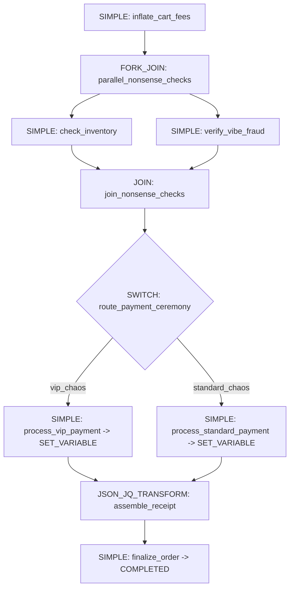
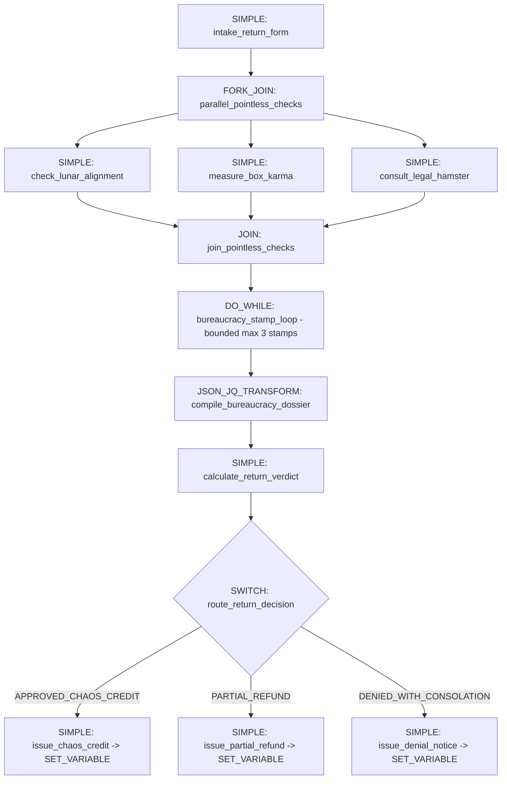

# Chaos Commerce™

> **A parody online store so bad that shoppers wonder how it's still in business — backed by real, rock-solid Conductor workflows.**

Behind the jokes, **checkout always completes** and **every return always reaches a decision**, orchestrated by two live Conductor workflows (`chaos_checkout` and `chaos_return_bureaucracy`) running on your Conductor server — with **zero AI API calls at runtime**.

---

## Parody Features

- **Ridiculous Prices & Mandatory Surcharges**: Buy an *Artisanal Single Paperclip (Pre-Bent)* for `$9,999.99` (was `$10,000.00` — save `$0.01`!), a *Left-Handed Wi-Fi Cable (Wireless, 0 ft)* for `$4,200.69`, or a *Box of Slightly Used Air (DMV Vintage)* for `$1,499.00` — plus mandatory *Convenience Inconvenience Fee*, *Digital Oxygen & Pixel Tax*, *CEO's Yacht Fuel Surcharge*, and *Gravity Calibration Fee*.
- **Reverse Promo Codes**: Applying `SAVE50`, `FREESHIP`, `CHAOS`, or `PLEASE` **increases** your total.
- **Inverted Reviews**: **5-star reviews full of incandescent fury** and **2-star reviews full of tearful praise**, plus a community Satisfaction Breakdown chart.
- **Cursor-Dodging 1-Star Button**: Try clicking `★ 1 Star` in the homepage rating widget or any product review form — it actively flees your mouse with a dodge counter and taunts. (Even bypassing it via raw API auto-upgrades 1★ to 5★ "by Legal.")
- **Pointless Returns Maze**: Survive an Astronomical & Emotional Audit (moon phase, regret level, absurd waivers) and an Impossible *"Select Squares Containing Inner Peace"* CAPTCHA before launching the Conductor return bureaucracy workflow.
- **Extra Absurdity**: Counting-**up** urgency timer, `BBB Rating: Z-` trust badges, absurd shipping methods (*Angry Carrier Pigeon*, *Catapult Delivery*), fake social proof regret toasts, oatmeal-raisin cookie banner, and **CHAOS-BOT 3000 (Certified 0% AI — 100% hardcoded unhelpfulness)**.
- **Live Conductor Telemetry**: Every completed checkout and return displays its real Conductor `workflowId`, task-by-task execution trace, durations, and a direct link to the Conductor UI.

---

## Quick Start (One Command)

Prerequisites:
- Node.js 22+
- Conductor OSS server already running at `http://localhost:8080` (API at `http://localhost:8080/api`). Chaos Commerce never stops, restarts, or replaces your Conductor server.

```bash
npm install
npm start
```

That single command (`npm start`) automatically:
1. Builds the static frontend (`frontend/dist`) if not already built.
2. Registers all 15 Conductor `SIMPLE` task definitions (`conductor/task-defs.json`) and both workflows (`chaos_checkout`, `chaos_return_bureaucracy`) on `CONDUCTOR_SERVER_URL`.
3. Starts the Conductor task workers polling `CONDUCTOR_SERVER_URL`.
4. Serves the backend API (`/api/*`) and frontend storefront at **`http://localhost:3000`**.

To run the automated end-to-end smoke test (while the store is running on `:3000`):

```bash
npm run smoke
```

---

## Configuration

Copy `.env.example` to `.env` (or pass environment variables directly):

| Variable | Default | Description |
|---|---|---|
| `CONDUCTOR_SERVER_URL` | `http://localhost:8080/api` | Conductor REST API base URL (`/api` is appended automatically if omitted) |
| `CONDUCTOR_UI_URL` | Derived from `CONDUCTOR_SERVER_URL` | Conductor UI base URL for execution deep-links |
| `CONDUCTOR_AUTH_KEY` | *(empty)* | Optional Orkes / remote Conductor API key |
| `CONDUCTOR_AUTH_SECRET` | *(empty)* | Optional Orkes / remote Conductor API secret |
| `PORT` | `3000` | Local server port |
| `CORS_ORIGIN` | `*` | Allowed CORS origin(s) for the backend API (set to your GitHub Pages origin in production) |
| `DATA_FILE` | `./data/chaos-commerce-data.json` | Local JSON persistence path (disabled automatically on AWS Lambda) |
| `VITE_API_BASE_URL` | *(empty — same-origin)* | Build-time backend API URL for the GitHub Pages frontend |

---

## Conductor Workflows

Both workflows are defined in `conductor/workflows/` with all 15 `SIMPLE` task definitions (including explicit timeouts and exponential-backoff retries) in `conductor/task-defs.json`.

### 1. `chaos_checkout` (v1) — Always Completes



Conductor UI definition link (local): `http://localhost:8080/workflowDef/chaos_checkout`

### 2. `chaos_return_bureaucracy` (v1) — Always Reaches a Decision



Conductor UI definition link (local): `http://localhost:8080/workflowDef/chaos_return_bureaucracy`

---

## Architecture & Deployment

The project is split into three clean layers:

```
conductor/        # Task definitions & Conductor workflow JSON definitions
backend/          # AWS Lambda handler (src/lambda.js), Express API, Conductor workers, AWS SAM template
frontend/         # Static React + Vite app deployable directly to GitHub Pages
```

### Deploy Backend to AWS Lambda (AWS SAM)

The backend exports an API Gateway HTTP API v2 / REST API v1 Lambda handler at `backend/src/lambda.js` and ships with `backend/template.yaml`.

```bash
cd backend
sam build
sam deploy --guided \
  --parameter-overrides \
    ConductorServerUrl=https://your-conductor-host.example.com/api \
    CorsOrigin=https://<your-github-username>.github.io
```

Note the `ApiBaseUrl` output (e.g., `https://abc123.execute-api.us-east-1.amazonaws.com`).

> **Workers in Production:** Conductor `SIMPLE` tasks require a polling worker process. Alongside AWS Lambda (which serves HTTP requests and triggers/polls workflows), run the lightweight stateless worker service anywhere with outbound HTTPS access to `CONDUCTOR_SERVER_URL` (ECS Fargate, EC2, Kubernetes, or a small VM):
>
> ```bash
> CONDUCTOR_SERVER_URL=https://your-conductor-host.example.com/api npm run workers
> ```
>
> `npm run register` can also be run once from CI/CD to register/update task and workflow definitions idempotently.

### Deploy Frontend to GitHub Pages

The frontend builds to a pure static bundle in `frontend/dist` with relative asset paths (`base: "./"`), so it works at both root domains and `/<repo-name>/` subpaths.

**Option A — Automated via GitHub Actions (`.github/workflows/deploy-pages.yml`):**
1. In your GitHub repo, go to **Settings → Pages** and select **GitHub Actions** as the source.
2. Under **Settings → Secrets and variables → Actions → Variables**, add `VITE_API_BASE_URL` pointing to your deployed AWS Lambda `ApiBaseUrl`.
3. Push to `main` (or trigger the workflow manually).

**Option B — Manual static build:**
```bash
VITE_API_BASE_URL=https://abc123.execute-api.us-east-1.amazonaws.com npm run build:frontend
# Publish frontend/dist to GitHub Pages
```

> You can also override the backend URL at runtime in the browser via `?api=https://...` or the **⚙️ Backend URL** button in the footer.

---

## Sensible Defaults Chosen (Unattended Run)

Because this build ran unattended, the following defaults were selected:

1. **Worker & Backend Language**: **Node.js 22 (ESM JavaScript)** using Express 4 + `serverless-http` and the official `@io-orkes/conductor-javascript` SDK (`^3.1.0`, chosen specifically because it has zero optional AI/LangChain dependencies).
2. **Frontend Stack**: **React 19 + Vite 6** building to static HTML/JS/CSS with relative paths (`base: "./"`) and inline SVG artwork (zero external image or font dependencies).
3. **AWS Lambda Packaging**: **AWS SAM (`backend/template.yaml`)** targeting `nodejs22.x` + API Gateway HTTP API with `ConductorServerUrl` and `CorsOrigin` template parameters.
4. **Conductor Configuration**: Defaults to `CONDUCTOR_SERVER_URL=http://localhost:8080/api` (Conductor OSS, unauthenticated), with optional `CONDUCTOR_AUTH_KEY` / `CONDUCTOR_AUTH_SECRET` support for Orkes/Enterprise clusters.
5. **Local Persistence**: In-memory store backed by `./data/chaos-commerce-data.json` locally (automatically skipped on AWS Lambda) and seeded with 2 sample historical orders so the Returns Maze can be tested immediately or with freshly placed orders.
6. **Zero Runtime AI Calls**: All workflow tasks, product copy, reviews, and the parody *CHAOS-BOT 3000* widget are 100% deterministic with no LLM/AI API calls.
