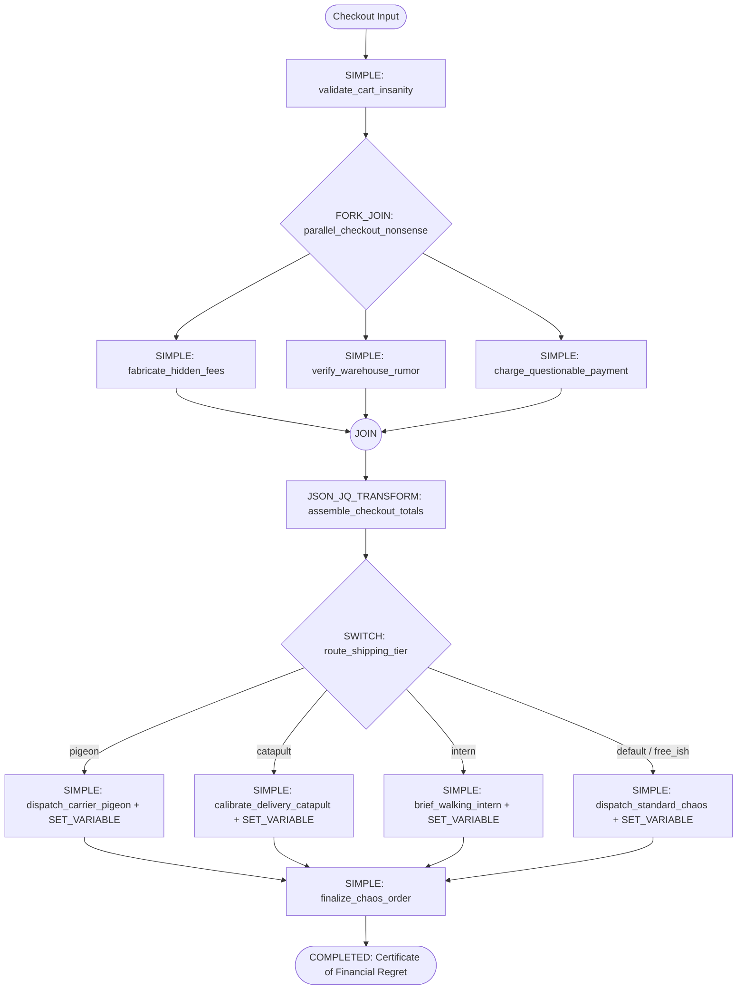
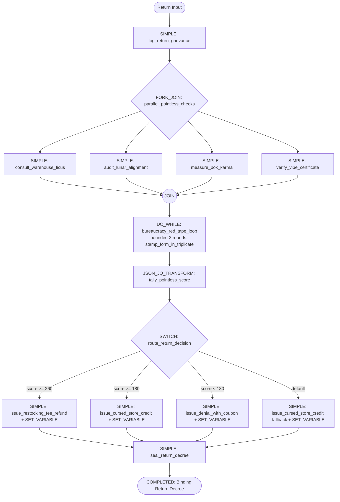

# CHAOS COMMERCE™

> *"Somehow Still Legally Operating Since 2019."*

**Chaos Commerce** is a parody online storefront engineered to be so absurdly awful that shoppers wonder how it is still in business—while secretly powered by rock-solid **Conductor** workflows so **checkout always completes** and **every return always reaches a concrete terminal decision**, with **zero AI APIs called at runtime**.

---

## Features & Absurdities

- **Ridiculous Pricing & Backwards Discounts**:
  - Wildly overpriced mundane junk (*Single Left Tube Sock (Slightly Damp)* — **WAS $12.50 → NOW $4,999.99**, *"PRICE HIKED +39,899%!"*) alongside suspiciously cheap industrial hazards (*12-Ton Industrial Forklift (Screws Sold Separately)* — **$0.03**).
  - Live **"Flash Sale Ended Xm Ys Ago!"** banner that counts *up* as prices supposedly keep rising, plus a scrolling **Live Regret Ticker**.
  - **Backwards Promo Codes** (`SAVE50` adds $50.00, `FREE` adds a $12.99 Free-Promo Processing Surcharge, `VIP` hikes subtotal by +15%, while secret code `CHAOS` grants a $0.01 discount).
  - Pre-checked **"Optional" $42.00 Cardboard Box** add-on and **Mandatory Hidden Fees** fabricated during checkout (*Convenience Inconvenience Fee*, *Pixel Delivery Surcharge*, *Gravity Compliance Levy*, *CEO Yacht Fuel Surcharge*).
- **Inverted Customer Reviews**:
  - **5-Star Reviews Full of Fury** (`★★★★★` — incandescent all-caps rage about ruined weddings and catapult roof craters).
  - **2-Star Reviews Full of Praise** (`★★☆☆☆` — tearful love letters praising life-changing craftsmanship).
- **The Dodging 1-Star Button**:
  - Inside every product's review composer, the **1-Star button** actively dodges the shopper's cursor inside a containment arena, tracks dodge attempts, cycles through taunts, and eventually suggests giving up and leaving a furious 5-star review instead.
- **Returns Buried in Pointless Checks**:
  - Form 1099-REGRET demands your Zodiac sign (including the "illegal 13th sign" Ophiuchus), a written apology to Warehouse B, sworn affidavits regarding moonlight exposure and original box air preservation, and an Anti-Spider Captcha.
  - Submitting triggers Conductor's `chaos_return_workflow`, which executes **4 parallel pointless checks** (including polling *Brenda the Warehouse Ficus*), loops through **3 rounds of bureaucratic stamping** (`DO_WHILE`), tallies a Pointless Compliance Score (`JSON_JQ_TRANSFORM`), and routes via `SWITCH` to one of three guaranteed terminal decisions:
    1. `APPROVED_WITH_RESTOCKING_FEE` — Cash refund minus a 42% Emotional Restocking Fee
    2. `APPROVED_STORE_CREDIT` — Cursed Store Credit redeemable exclusively Tuesdays 2:00–2:04 AM GMT
    3. `DENIED_WITH_COUPON` — Denied on technicality, accompanied by a $0.17 Consolation Coupon
- **Customer Disservice Widget**:
  - Deterministic, zero-AI floating chat widget (*ChazBot 0.01 — Powered by Spite, Not AI*) that prints and shreds your complaints.

---

## One-Command Local Startup

Make sure the Conductor server is already running at `http://localhost:8080` (API at `/api`), then run:

```bash
npm start
```

That single command (`scripts/start-all.mjs`):
1. Installs backend/frontend dependencies if missing.
2. Builds the static frontend bundle (`frontend/dist`) if missing (set `REBUILD_FRONTEND=true npm start` to force a rebuild).
3. Idempotently registers all **19 Conductor `SIMPLE` task definitions** (`workflows/tasks.json`) and both workflows (`workflows/chaos_checkout_workflow.json` and `workflows/chaos_return_workflow.json`) against `CONDUCTOR_SERVER_URL`.
4. Starts the Node.js Conductor workers polling all 19 task queues.
5. Starts the HTTP server serving both the API and storefront at **http://localhost:3000**.

---

## Sensible Defaults Chosen (Unattended Run Log)

Because this run was unattended, the following defaults were selected and documented here:

| Decision | Chosen Default | Notes / How to Override |
|---|---|---|
| **Worker & Backend Language** | Node.js 22 (ESM `.mjs`) with `@io-orkes/conductor-javascript` v4 + Express 4 + `serverless-http` | Keeps the entire repo single-language JS, installs cleanly (`backend/.npmrc` sets `legacy-peer-deps=true` to avoid pulling unused optional AI framework peers), and runs identically in local Node and AWS Lambda. |
| **Frontend Stack** | React 19 + Vite 7 static SPA (`base: "./"`) | Zero runtime SSR dependencies; builds to static files in `frontend/dist` ready for GitHub Pages at root `/` or `/<repo-name>/`. |
| **Conductor Server URL** | `http://localhost:8080/api` (OSS, unauthenticated) | Configured via `CONDUCTOR_SERVER_URL` env var (automatically appends `/api` if omitted). Supports optional `CONDUCTOR_AUTH_KEY` / `CONDUCTOR_AUTH_SECRET` for Orkes Conductor. |
| **Order & Return Persistence** | Authoritative state stored in Conductor executions (stateless backend) | `GET /api/orders`, `GET /api/returns`, and `GET /api/workflows/:id` read directly from Conductor so the AWS Lambda backend needs no separate database. User-submitted product reviews are held in memory alongside seeded catalog reviews. |
| **Worker Execution Model** | Embedded in local `npm start`; standalone `npm run worker` (`backend/src/workerRunner.mjs`) for production alongside AWS Lambda | Local one-command UX stays clean in a single process; production deployments run the API on AWS Lambda and the stateless polling worker process wherever convenient (ECS Fargate, container, or VM). |
| **Step Theatrical Delay** | `CHAOS_STEP_DELAY_MS=120` (120ms per worker task) | Makes the live Conductor workflow timeline visibly animate in the browser while finishing checkout and returns in ~1–2 seconds. Set `CHAOS_STEP_DELAY_MS=0` for instant execution. |
| **Runtime AI Usage** | **None (`0%`)** | All workflow steps, fees, return audits, and Customer Disservice replies are 100% deterministic JavaScript + Conductor system tasks. |

---

## Conductor Workflows

Workflow definitions live in `workflows/` and are registered automatically on startup (or manually via `npm run register`):

- **Checkout Workflow UI**: `http://localhost:8080/workflowDef/chaos_checkout_workflow`
- **Returns Workflow UI**: `http://localhost:8080/workflowDef/chaos_return_workflow`

### 1. `chaos_checkout_workflow`



### 2. `chaos_return_workflow`



---

## Configuration

Copy `.env.example` or export environment variables as needed:

| Variable | Default | Used By | Description |
|---|---|---|---|
| `CONDUCTOR_SERVER_URL` | `http://localhost:8080/api` | Backend & Workers | Conductor REST API base URL (`/api` appended automatically if missing). |
| `CONDUCTOR_UI_URL` | Derived from `CONDUCTOR_SERVER_URL` | Backend | Public Conductor UI URL returned to the frontend for execution inspection links. |
| `CONDUCTOR_AUTH_KEY` | *(empty)* | Backend & Workers | Optional Orkes Conductor access key (not needed for local OSS Conductor). |
| `CONDUCTOR_AUTH_SECRET` | *(empty)* | Backend & Workers | Optional Orkes Conductor access secret. |
| `PORT` | `3000` | Local Server | HTTP port for the combined local storefront & API server. |
| `CORS_ORIGIN` | `*` | Backend / Lambda | Comma-separated allowed origins (set to `https://<user>.github.io` in production). |
| `CHAOS_STEP_DELAY_MS` | `120` | Workers | Optional per-task delay in milliseconds for visual pacing (`0` for fastest execution). |
| `VITE_API_BASE_URL` | *(empty — same-origin)* | Frontend build | Backend API base URL (e.g., your AWS Lambda API Gateway endpoint) baked in at build time. |

Alternatively, static GitHub Pages deployments can override the API URL **without rebuilding** by editing `frontend/public/config.js` (copied to `frontend/dist/config.js`):

```js
window.__CHAOS_CONFIG__ = {
  apiBaseUrl: "https://your-api-id.execute-api.us-east-1.amazonaws.com",
};
```

---

## Project Structure

```text
.
├── package.json                          # Root scripts (`npm start`, `npm test`, `npm run register`)
├── scripts/start-all.mjs                 # Single-command launcher (build -> register -> workers -> :3000)
├── workflows/
│   ├── tasks.json                        # 19 SIMPLE task definitions (with timeouts & retry policies)
│   ├── chaos_checkout_workflow.json      # Checkout Conductor workflow
│   └── chaos_return_workflow.json        # Returns Conductor workflow
├── backend/
│   ├── template.yaml                     # AWS SAM template for AWS Lambda + HTTP API Gateway
│   ├── src/
│   │   ├── app.mjs                       # Stateless Express API (shared by Lambda and local server)
│   │   ├── lambda.mjs                    # AWS Lambda handler (`serverless-http`)
│   │   ├── server.mjs                    # Local HTTP server + embedded workers + static frontend
│   │   ├── workers.mjs                   # All 19 Conductor SIMPLE task workers
│   │   ├── workerRunner.mjs              # Standalone worker process for production deployments
│   │   ├── conductorClient.mjs           # Conductor REST API client (reads CONDUCTOR_SERVER_URL)
│   │   ├── registerWorkflows.mjs         # Idempotent task & workflow registrar
│   │   ├── catalog.mjs                   # Absurd products, reviews, shipping tiers, promo codes
│   │   ├── store.mjs                     # Review overlay & Conductor execution formatter
│   │   └── config.mjs                    # Environment configuration loader
│   └── test/api.test.mjs                 # End-to-end integration tests against real Conductor + Lambda
├── frontend/
│   ├── vite.config.js                    # `base: "./"` for root or subpath GitHub Pages hosting
│   ├── public/config.js                  # Optional runtime API base URL override
│   └── src/                              # React storefront, dodging 1★ widget, live workflow timelines
└── .github/workflows/deploy-pages.yml    # GitHub Actions workflow to deploy frontend/ to GitHub Pages
```

---

## Deploying to Production

### 1. Deploy Backend to AWS Lambda (via AWS SAM)

The backend API entrypoint is `backend/src/lambda.mjs` (`handler`) and is packaged with `backend/template.yaml`:

```bash
cd backend
npm ci --omit=dev
sam build
sam deploy --guided \
  --parameter-overrides \
    ConductorServerUrl="https://your-conductor-host.example.com/api" \
    CorsOrigin="https://<your-github-username>.github.io"
```

After deployment, note the `ApiEndpoint` output (e.g. `https://abc123.execute-api.us-east-1.amazonaws.com`).

### 2. Register Workflows & Run Workers Against Your Production Conductor Server

Because AWS Lambda serves HTTP API requests on demand, run the stateless Conductor task poller alongside your Conductor server (e.g. ECS Fargate, Docker container, or a small VM):

```bash
export CONDUCTOR_SERVER_URL="https://your-conductor-host.example.com/api"
npm run register   # Idempotently registers tasks.json + both workflows
npm run worker     # Polls all 19 SIMPLE task queues
```

### 3. Deploy Frontend to GitHub Pages

1. Push this repository to GitHub.
2. In **Settings → Pages**, set **Source** to **GitHub Actions**.
3. In **Settings → Secrets and variables → Actions → Variables**, add a repository variable:
   - `CHAOS_API_BASE_URL` = your AWS Lambda `ApiEndpoint` URL (no trailing slash).
4. Push to `main` (or trigger the **Deploy Chaos Commerce Frontend to GitHub Pages** workflow manually).

To build manually for static hosting:

```bash
VITE_API_BASE_URL="https://abc123.execute-api.us-east-1.amazonaws.com" npm run build:frontend
# Upload frontend/dist/ to GitHub Pages (or any static host)
```

---

## Testing

Run the automated integration test suite (verifies Conductor connectivity, zero runtime AI APIs, all 4 checkout shipping routes, all 3 return decision routes, and AWS Lambda API Gateway v2 event handling):

```bash
npm test
```
