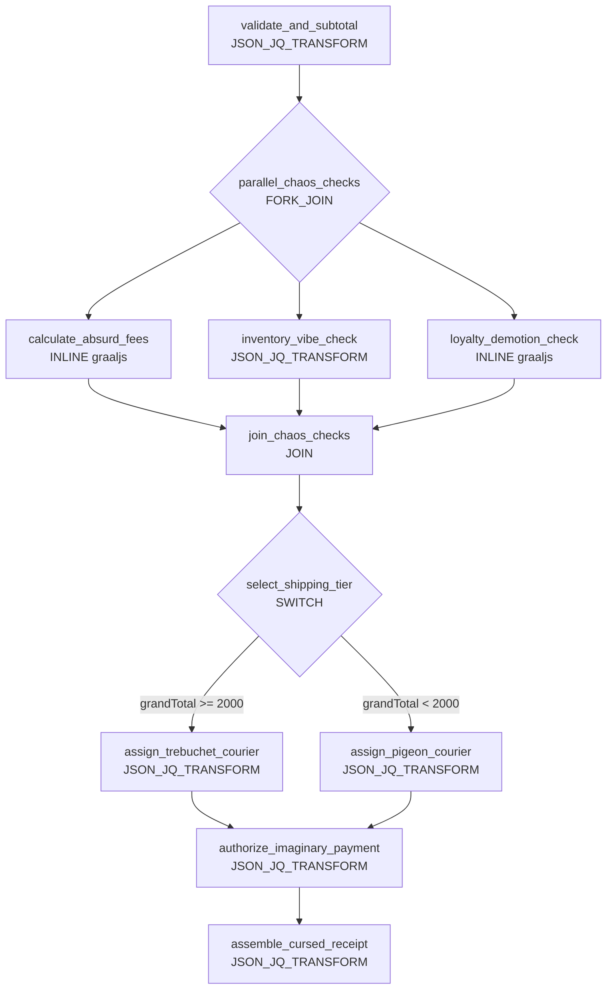
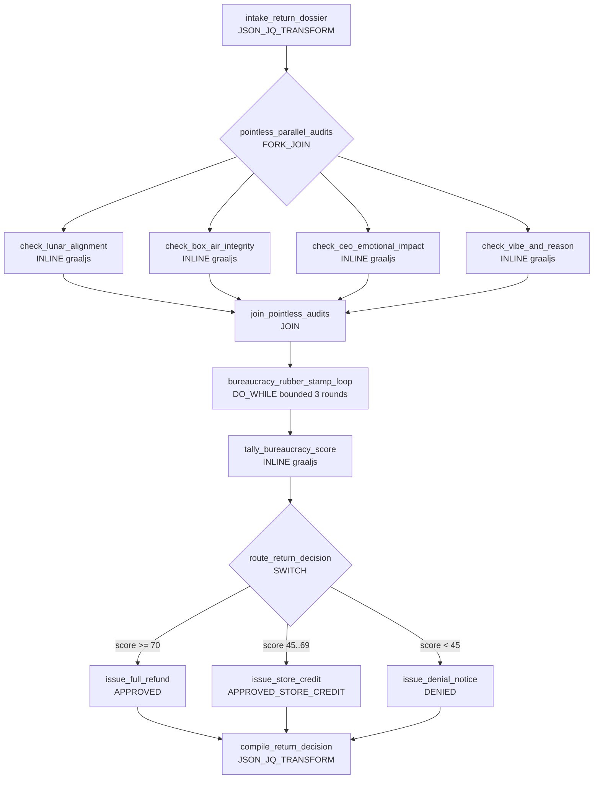

# Chaos Commerce™

> *Disrupting Common Sense Since Five Minutes Ago*

**Chaos Commerce** is a parody online store so bad that shoppers wonder how it is still in business—complete with ridiculous prices (`$499.99` melting ice cubes, `$2,450.00` pre-dented empty boxes, "SAVE `-$0.01`!" badges), incandescent **5-star reviews full of fury** and ecstatic **2-star reviews full of praise**, a **1-star button that dodges the cursor**, a **promo code that increases your total**, a **resetting 9-second flash sale timer**, a **4,118-cookie banner**, **ChadGPT-0.01** (14 deterministic `if`-statements, zero AI APIs), and a **returns process buried in pointless bureaucratic checks**.

Behind the jokes, the engineering is rock-solid:
- **Checkout always completes** via the `chaos_checkout_workflow` Conductor workflow.
- **Every return always reaches a clear decision** (`APPROVED`, `APPROVED_STORE_CREDIT`, or `DENIED`) via the `chaos_return_workflow` Conductor workflow.
- **Zero AI APIs are called at runtime**—everything is 100% deterministic.
- **Frontend (`frontend/`)** is a static bundle ready for **GitHub Pages** (relative assets, hash routing, runtime & build-time API URL config).
- **Backend (`backend/`)** is a zero-dependency Node.js 22 service ready for **AWS Lambda + API Gateway** (`backend/src/lambda.mjs` + `backend/template.yaml`), reading `CONDUCTOR_SERVER_URL` from configuration.

---

## Quick Start (One Command)

Make sure your Conductor server is running at `http://localhost:8080` (API at `http://localhost:8080/api`), then run:

```bash
npm start
```

That single command:
1. Connects to Conductor using `CONDUCTOR_SERVER_URL` (defaults to `http://localhost:8080/api`) without stopping, restarting, or replacing the server.
2. Registers/updates `chaos_checkout_workflow` (v1) and `chaos_return_workflow` (v1) on Conductor.
3. Builds the static frontend bundle (`frontend/dist`) if missing or outdated.
4. Starts the Chaos Commerce server at **http://localhost:3000** serving both the storefront UI and `/api/*`.

---

## Project Structure

```text
.
├── package.json                          # Root one-command runner (`npm start`, `npm test`)
├── scripts/start.mjs                     # Registers workflows, builds frontend, serves on :3000
├── workflows/
│   ├── chaos_checkout_workflow.json      # Checkout Conductor workflow (always completes)
│   ├── chaos_return_workflow.json        # Returns Conductor workflow (always reaches a decision)
│   └── register.mjs                      # Idempotent Conductor workflow registration script
├── backend/                              # AWS Lambda-ready Node 22 backend (zero runtime deps)
│   ├── template.yaml                     # AWS SAM template (Lambda + HTTP API Gateway + CORS)
│   ├── src/
│   │   ├── config.mjs                    # Reads CONDUCTOR_SERVER_URL & runtime config from env/.env
│   │   ├── app.mjs                       # HTTP-agnostic API router shared by Lambda & local server
│   │   ├── lambda.mjs                    # AWS Lambda handler (API Gateway v2, v1, Function URLs)
│   │   ├── server.mjs                    # Local HTTP server (serves /api/* + frontend/dist)
│   │   ├── data/catalog.mjs              # Parody catalog, 5★ fury / 2★ praise reviews, ChadGPT-0.01
│   │   └── services/
│   │       ├── conductorClient.mjs       # Conductor REST API client (OSS & Enterprise auth)
│   │       └── storeState.mjs            # Review storage + catalog merge
│   └── test/backend.test.mjs             # Live Lambda-handler + Conductor integration tests
├── frontend/                             # GitHub Pages-ready React + Vite static SPA
│   ├── vite.config.mjs                   # Relative base (`./`) for subpath-safe GitHub Pages hosting
│   ├── public/config.js                  # Runtime API URL override (`window.__CHAOS_CONFIG__`)
│   └── src/
│       ├── api.js                        # API client resolving runtime/build-time backend URL
│       ├── App.jsx                       # Storefront shell, hash routing, urgency banner, cookies
│       └── components/
│           ├── ProductArtwork.jsx        # 8 custom SVG illustrations (zero external image deps)
│           ├── DodgingStarPicker.jsx     # 1★ button that actively dodges the pointer
│           ├── ProductModal.jsx          # Specs, unhinged reviews, review submission
│           ├── CheckoutPanel.jsx         # Cart, absurd fees, promo penalty, Conductor receipt
│           ├── ReturnsPanel.jsx          # 4-check return gauntlet + Conductor decision report
│           ├── OrdersInspector.jsx       # Live Conductor workflow execution ledger
│           ├── WorkflowTrace.jsx         # Task-by-task Conductor trace + UI deep-link
│           └── ChadSupportWidget.jsx     # Deterministic parody support chat (no AI APIs)
└── .github/workflows/deploy-pages.yml    # Automated GitHub Pages deployment workflow
```

---

## Conductor Workflows

Both workflows use **built-in Conductor system tasks only** (`JSON_JQ_TRANSFORM`, `FORK_JOIN`, `JOIN`, `DO_WHILE`, `SWITCH`, `INLINE` with `evaluatorType: "graaljs"`). Because there are zero unregistered `SIMPLE` tasks, no external worker daemon is required—the workflows run natively on Conductor both locally and when called from AWS Lambda.

### 1. `chaos_checkout_workflow` (v1)
Conductor UI (local): `http://localhost:8080/workflowDef/chaos_checkout_workflow`



### 2. `chaos_return_workflow` (v1)
Conductor UI (local): `http://localhost:8080/workflowDef/chaos_return_workflow`



---

## Configuration

Copy `.env.example` to `.env` (or pass environment variables directly):

| Variable | Default | Description |
|---|---|---|
| `CONDUCTOR_SERVER_URL` | `http://localhost:8080/api` | Conductor REST API base URL (`/api` appended automatically if omitted). |
| `CONDUCTOR_UI_URL` | Derived from `CONDUCTOR_SERVER_URL` | Base URL for Conductor UI execution deep-links. |
| `CONDUCTOR_AUTH_TOKEN` | *(empty)* | Optional bearer token for authenticated Conductor deployments. |
| `CONDUCTOR_AUTH_KEY` / `CONDUCTOR_AUTH_SECRET` | *(empty)* | Optional Orkes Conductor key/secret pair (exchanged in memory at `/api/token`; never logged). |
| `PORT` | `3000` | Local HTTP port for `npm start`. |
| `CORS_ORIGIN` | `*` | Allowed CORS origin returned by API responses (lock down to `https://<user>.github.io` in Lambda). |
| `VITE_API_BASE_URL` | `""` | Build-time backend API URL for the frontend (empty = same-origin `/api` locally). |

---

## Deployment

### 1. Register Workflows on Your Target Conductor Server

```bash
CONDUCTOR_SERVER_URL=https://your-conductor-server.example.com/api npm run register-workflows
```

*(If targeting Orkes/Enterprise Conductor, inject `CONDUCTOR_AUTH_TOKEN` or `CONDUCTOR_AUTH_KEY`/`CONDUCTOR_AUTH_SECRET` via your environment or CI secret store.)*

### 2. Deploy the Backend to AWS Lambda

The `backend/` directory contains `template.yaml` (AWS SAM) and `src/lambda.mjs` with zero external `node_modules` dependencies:

```bash
cd backend
sam build
sam deploy --guided \
  --parameter-overrides \
    ConductorServerUrl=https://your-conductor-server.example.com/api \
    CorsOrigin=https://<your-github-username>.github.io
```

Note the `ChaosCommerceApiUrl` output printed by SAM (for example `https://abc123def.execute-api.us-east-1.amazonaws.com`).

*(Alternative without SAM: zip `backend/src/` and `backend/package.json`, upload to a Node.js 22.x AWS Lambda function with handler `src/lambda.handler`, attach an API Gateway HTTP API or Lambda Function URL, and set the `CONDUCTOR_SERVER_URL` and `CORS_ORIGIN` environment variables.)*

### 3. Deploy the Frontend to GitHub Pages

**Option A — Automated GitHub Actions (recommended):**
1. Push this repository to GitHub.
2. In your repository settings, go to **Settings → Pages** and set **Source** to **GitHub Actions**.
3. Go to **Settings → Secrets and variables → Actions → Variables** and create a repository variable named `API_BASE_URL` set to your AWS Lambda API URL (`ChaosCommerceApiUrl`).
4. Push to `main` (or trigger `.github/workflows/deploy-pages.yml` manually).

**Option B — Runtime configuration without rebuilding:**
Edit `frontend/public/config.js` (or `frontend/dist/config.js` after `npm run build`) and set:
```js
window.__CHAOS_CONFIG__ = {
  apiBaseUrl: "https://your-lambda-api.execute-api.us-east-1.amazonaws.com",
};
```
You can also test any backend URL on the fly by appending `?api=https://your-lambda-api...` to the GitHub Pages URL.

---

## Running Tests

With Conductor running at `http://localhost:8080/api`:

```bash
npm test
```

Runs `backend/test/backend.test.mjs`, exercising the AWS Lambda handler (`v2` & `v1` events), CORS preflight, Conductor health checks, product catalog, live `chaos_checkout_workflow` execution, and live `chaos_return_workflow` executions across approval and denial branches.

---

## Sensible Defaults Chosen (Unattended Run Log)

Because this project was built in an unattended run, the following defaults were selected wherever a tool, skill, or architectural choice would ordinarily ask for a preference:

1. **Conductor server profile & flavor**: Probed `http://localhost:8080/api` unauthenticated and detected an OSS Conductor server; used it directly without creating global CLI profiles or installing global packages, and never stopped, restarted, or replaced the server.
2. **Conductor task architecture (pure built-in system tasks vs. `SIMPLE` polling workers)**: Implemented both `chaos_checkout_workflow` and `chaos_return_workflow` purely with Conductor built-in system tasks (`JSON_JQ_TRANSFORM`, `FORK_JOIN`, `JOIN`, `DO_WHILE`, `SWITCH`, `INLINE` with `evaluatorType: "graaljs"`). This avoids needing a separate always-on worker fleet alongside AWS Lambda, satisfies the Conductor Worker Gate with zero unregistered `SIMPLE` tasks, and keeps execution fast and deterministic.
3. **Backend stack**: Node.js 22 ESM with zero external runtime dependencies (`backend/src/app.mjs` shared by `backend/src/lambda.mjs` and `backend/src/server.mjs`) and AWS SAM (`backend/template.yaml`) as the default Lambda deployment descriptor.
4. **Frontend stack**: React 19 + Vite 6 configured with relative asset paths (`base: './'`), hash routing (`#/shop`, `#/cart`, `#/returns`, `#/orders`), and inline SVG product artwork so the static output works cleanly on GitHub Pages subpaths without 404 rewrites or external image dependencies.
5. **State persistence**: Orders and return decisions are read directly from Conductor workflow executions (`/api/workflow/search` + `/api/workflow/{id}`) so they persist across local restarts and AWS Lambda cold starts. Newly posted product reviews persist to `backend/.data/reviews.json` locally and fall back to `/tmp` / in-memory in AWS Lambda (swap `storeState.mjs` to DynamoDB if multi-instance persistent Lambda reviews are needed).
6. **Zero AI APIs at runtime**: All product copy, fee inflation, return checks, and the ChadGPT-0.01 parody chat widget run purely via deterministic JavaScript and Conductor system tasks.
